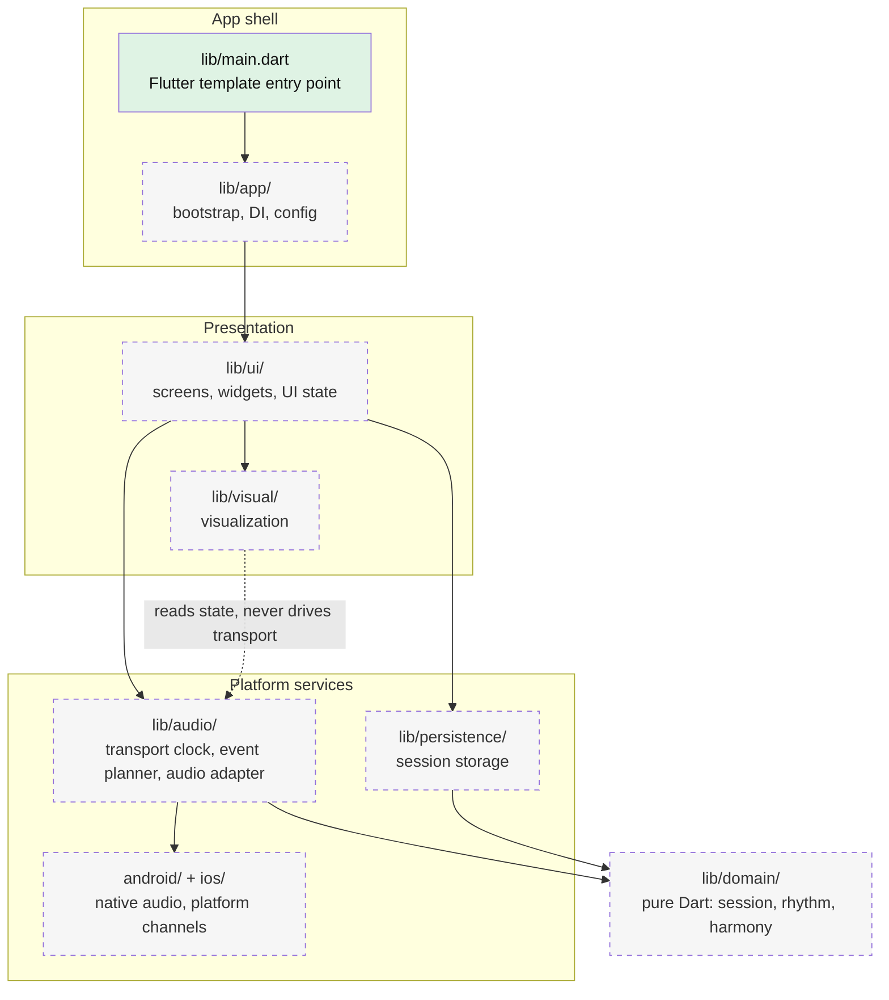

# synesterra-mobile
Standalone Flutter/Dart app for Synesterra on Android and iOS.

This repository is reserved for the native mobile app. The existing TypeScript web/PWA laboratory lives in [synesterra-web](https://github.com/KornelSzyszka/synesterra-web).

Current status: Flutter scaffold and CI only. The app logic and physical-device audio validation have not started yet.

## Architecture

Target module layout and dependency direction (`ui` depends on `audio`/`persistence`, which depend on `domain`; `domain` imports neither Flutter nor plugins). Solid boxes exist in the repository today; dashed boxes are planned and have no code yet.

`android/` and `ios/` exist as Flutter-generated runner projects; the native audio code in them is planned.

Quality gates: format, analyze, test and a debug APK build run in [CI](.github/workflows/ci.yml); iOS is built on demand. Emulator runs and unit tests do not prove audio timing or behaviour on a physical phone.

Agent collaboration rules and model routing: [docs/agents](docs/agents/README.md).
