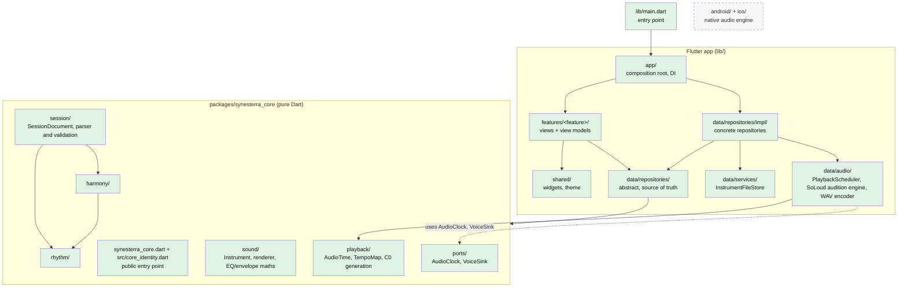

# Architecture

Hybrid DDD-lite, as described in [decision 0001](decisions/0001-architecture-style.md) (accepted). It has a pure Dart core with music logic and ports, a Flutter app built with MVVM and grouped by feature, and audio behind adapters. Solid boxes exist in the repository today. Dashed boxes are planned and have no code yet.

Dependency rules R1–R9 and the real-time hand-off (who owns audio time, runtime state and stale-event cancellation) are in decision 0001; [architecture tests](modules/architecture-tests.md) enforce the import boundaries. In short:
- the core imports nothing from Flutter, plugins or I/O;
- features reach data only through abstract repositories;
- data never imports the UI;
- only `app/` imports concrete implementations.

The existing nodes above are backed by `lib/data/services/`, `lib/data/audio/`,
`packages/synesterra_core/lib/src/{sound,playback,ports,session,rhythm,harmony}/`,
`lib/features/`, `lib/shared/` and `lib/app/`. `android/` and `ios/` contain
Flutter-generated runner projects; no repository-owned native audio implementation
is present in them yet.

Update this diagram in the same PR that adds or moves a module; change the box style from planned to existing when code lands.
