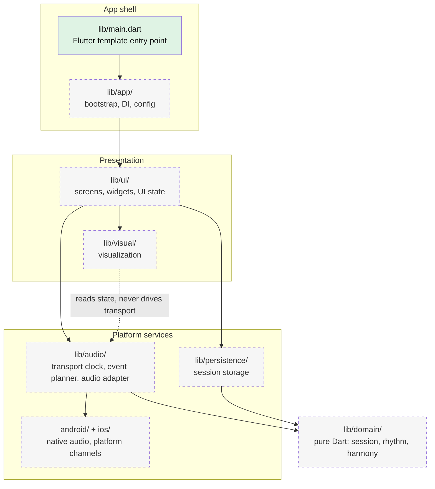

# Architecture

Target module layout and dependency direction (`ui` depends on `audio`/`persistence`, which depend on `domain`; `domain` imports neither Flutter nor plugins). Solid boxes exist in the repository today; dashed boxes are planned and have no code yet.

`android/` and `ios/` exist as Flutter-generated runner projects; the native audio code in them is planned.

Update this diagram in the same PR that adds or moves a module; change the box style from planned to existing when code lands.
