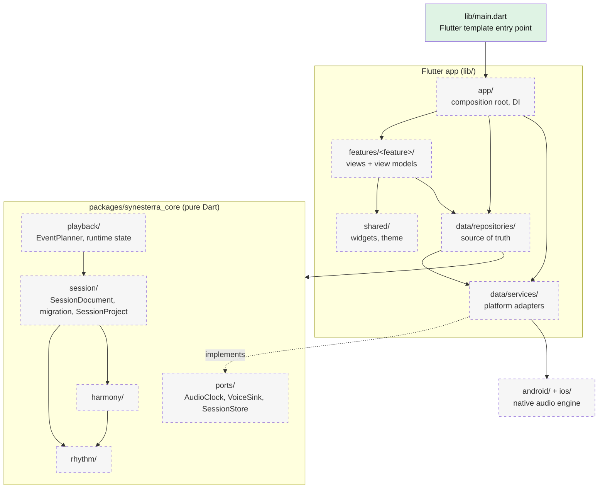

# Architecture

Hybrid DDD-lite, as described in [decision 0001](decisions/0001-architecture-style.md) (proposed). It has a pure Dart core with music logic and ports, a Flutter app built with MVVM and grouped by feature, and native audio behind adapters. Solid boxes exist in the repository today. Dashed boxes are planned and have no code yet.

Dependency rules R1–R8 are listed in decision 0001 and will be enforced by architecture tests. In short:
- the core imports nothing from Flutter, plugins or I/O;
- features never import each other or platform services;
- data never imports the UI;
- only `app/` wires concrete implementations.

`android/` and `ios/` exist as Flutter-generated runner projects; the native audio code in them is planned.

Update this diagram in the same PR that adds or moves a module; change the box style from planned to existing when code lands.
