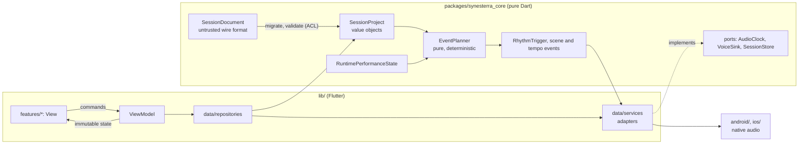

# 0001 — Architecture style: hybrid DDD-lite

- **Status:** proposed. Needs Founder acceptance (`architecture` gate, issue #9).
- **Date:** 2026-10-01
- **Enforced by:** architecture tests (#10), once this ADR is accepted.

## Context

Synesterra is a practice instrument for polyrhythm and harmony: Polyrhythmer (rhythm layers, cycle, subdivisions, transport) and Resonara (scale context, drone, sparse harmonic changes anchored to common steps). The web/PWA laboratory in `synesterra-web` is the reference for behaviour, not code to share.

Forces:

- **Real-time audio is the core risk.** Timing must be deterministic and testable without a device; the audio clock, not UI timers, is the time source.
- **The audio backend is undecided.** Oboe/AAudio on Android and AVAudioEngine on iOS are candidates. This ADR must leave room for that decision instead of making it.
- **Accepted contracts already exist.** `SessionDocument v2` (web PLR-010) and the core boundary `SessionDocument → SessionProject + RuntimePerformanceState → EventPlanner → platform scheduler → VoiceSink` (web PLR-004).
- **Local first.** One user, no backend on the audio path, no concurrent writers.
- **Built by one Founder and AI agents.** Boundaries must be explicit and machine-checkable. Ceremony that adds files without adding safety costs every task.

## Decision

A hybrid that uses each approach only where it pays off:

| From | We take | We leave out |
|---|---|---|
| DDD (strategic) | Shared vocabulary, bounded contexts, immutable value objects that validate on construction, an anti-corruption layer for document import | — |
| DDD (tactical) | — | Aggregates, domain events, repository-per-aggregate, CQRS (see *Not now*) |
| Functional core / imperative shell | `EventPlanner` and all music maths as pure, deterministic functions; side effects only at the edges | — |
| Hexagonal (ports and adapters) | The core defines ports (`AudioClock`, `VoiceSink`, `SessionStore`); native audio and storage are adapters | A port for things with one implementation and no test value |
| Flutter MVVM (official app architecture guide) | Views without logic, view models, repositories as the source of truth, services wrapping platform APIs, immutable state, one-way data flow, dependency injection, fakes in tests | A domain/use-case layer per action (the core already is the domain) |
| Feature-first | UI grouped by feature (`rhythm`, `harmony`, `library`, `settings`) | Feature folders inside the core (the core is split by context) |

### Layout

```text
pubspec.yaml                      Flutter app; pub workspace root
packages/synesterra_core/         pure Dart; no Flutter, no plugins, no dart:io/dart:ui
  lib/src/rhythm/                 layers, patterns, cycle, subdivisions, phase, swing
  lib/src/harmony/                scale context, drone, harmonic changes on common steps
  lib/src/session/                SessionDocument (wire format), migration, validation, SessionProject
  lib/src/playback/               RuntimePerformanceState, EventPlanner, RhythmTrigger, transport maths
  lib/src/ports/                  AudioClock, VoiceSink, SessionStore (abstract)
  test/                           run with `dart test`
lib/
  main.dart                       calls app/ only
  app/                            composition root: builds services, repositories, view models
  data/repositories/              abstract repository + implementation per data type
  data/services/                  adapters: platform channels, native audio bridge, files
  features/<feature>/             views (widgets) and view models of one feature
  shared/                         widgets, theme and formatting used by 2+ features
android/, ios/                    native audio engine and platform channel handlers
```

### Data flow



The native side owns the real-time schedule. Dart plans events ahead over half-open ranges (`from <= event < to`) and hands them over. How far ahead, over which channel and on which thread is the audio backend ADR's call, not this one's.

### Dependency rules

These are the input for the architecture tests (#10). "Imports" means `import` and `export` directives.

1. **R1 — pure core.** `packages/synesterra_core` imports only `dart:core`, `dart:async`, `dart:math`, `dart:collection`, `dart:convert`, `dart:typed_data` and its own files. It never imports `package:flutter`, a plugin, `dart:io` or `dart:ui`.
2. **R2 — core contexts.** `rhythm` imports no other context. `harmony` may import `rhythm` (changes are anchored to rhythm steps). `session` may import `rhythm` and `harmony`. `playback` may import every context. `ports` may import types from every context. No context imports `playback` except `ports`.
3. **R3 — public core API.** Code outside the core imports only `package:synesterra_core/synesterra_core.dart` (or a documented library next to it), never `src/`.
4. **R4 — features are isolated.** `lib/features/<a>/` never imports `lib/features/<b>/`. Shared code moves to `lib/shared/` or the core.
5. **R5 — the UI never touches the platform.** `lib/features/` and `lib/shared/` do not import `lib/data/services/`, `package:flutter/services.dart` platform-channel APIs or plugins. They reach data only through repositories.
6. **R6 — data does not know the UI.** `lib/data/` never imports `lib/features/`, `lib/shared/` or `lib/app/`.
7. **R7 — one composition root.** Only `lib/app/` constructs concrete services and repositories. `lib/main.dart` imports only `lib/app/`.
8. **R8 — no cycles.** There are no import cycles between directories listed above.

Not enforceable by import analysis, so review checks it instead: visualization reads transport position and never issues transport commands; widgets contain no business logic; every value object validates in its constructor.

### Enforcement

- `packages/synesterra_core` has no Flutter dependency, and CI runs its tests with `dart test`. A Flutter import in the core then fails to run, because `dart:ui` does not exist on the Dart VM. A pub workspace shares one package map, so the pubspec boundary alone does not stop the import; the `dart test` run and R1 do.
- `test/architecture/` parses directives and asserts R1–R8 with no new dependencies, inside the existing `flutter test` CI step. A broken fixture per rule proves that the rule fails.

### State and injection

ViewModels use `ChangeNotifier`/`ValueListenable` from the SDK, and the composition root injects through constructors. A state-management or DI package (`provider`, `riverpod`, `get_it`) is not added until a concrete need appears. That is a separate decision.

## Alternatives considered

| Option | Why not as the whole architecture |
|---|---|
| Full tactical DDD | Aggregates, domain events and CQRS solve consistency between concurrent writers and complex business transactions; this app has neither. The extra types and indirection slow every agent task without adding safety. |
| Plain Flutter MVVM (no separate core) | Strong for UI and data, silent about real-time determinism; music maths would drift into repositories and view models and become testable only through Flutter. |
| Clean Architecture with a use case per action | One class per button adds boilerplate; the core functions already are the use cases. |
| Hexagonal only | Fixes the core boundary but gives no structure for UI growth. |
| Functional core only | Says nothing about platform adapters or UI organisation. |

## Consequences

- Positive: the riskiest code (planner, maths, migration) is pure Dart, fast to test, and can carry property tests; the audio backend can change behind `VoiceSink`/`AudioClock`; boundaries are checked in CI rather than remembered by agents.
- Negative: two packages and a workspace to maintain; mapping between `SessionProject` and view state is explicit code; agents must learn the vocabulary (kept in the core's doc comments and `docs/modules/`).
- Neutral: `docs/architecture.md` changes to this layout (all modules still planned).

## Not now, and when to revisit

| Deferred | Revisit when |
|---|---|
| Aggregates and transactional boundaries | sync with a backend or multi-device editing arrives |
| Domain events | undo/redo, analytics or sync need an event history |
| A state-management/DI package | a concrete pain point appears with constructor injection and `ChangeNotifier` |
| An IDE lint plugin for the rules | the architecture test is not enough feedback during editing |

## Follow-ups

- #10: architecture tests and the `packages/synesterra_core` workspace (verify the pub workspace setup with Flutter 3.35.7 in that task).
- Audio backend ADR (`AUD`, `architecture` gate): native engine, scheduling hand-off, threads and latency measurement.
- First `DOM` tasks: value objects and `SessionDocument v2` parsing in the core, following web PLR-010.
