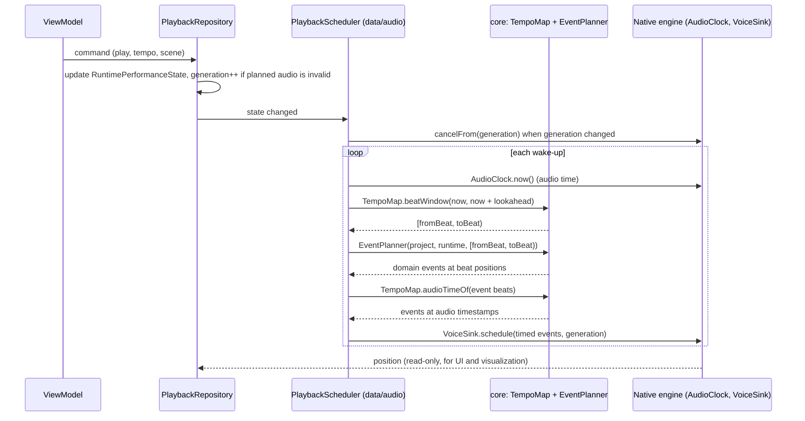

# 0001 — Architecture style: hybrid DDD-lite

- **Status:** accepted by the Founder on 2026-10-01 (`architecture` gate, issue #9).
- **Date:** 2026-10-01
- **Enforced by:** architecture tests (#10).

## Context

Synesterra is a practice instrument for polyrhythm and harmony: Polyrhythmer (rhythm layers, cycle, subdivisions, transport) and Resonara (scale context, drone, sparse harmonic changes anchored to common steps). The web/PWA laboratory in `synesterra-web` is the reference for behaviour, not code to share.

Forces:

- **Real-time audio is the core risk.** Timing must be deterministic and testable without a device; the audio clock, not UI timers, is the time source.
- **The audio backend is undecided.** Oboe/AAudio on Android and AVAudioEngine on iOS are candidates. This ADR fixes the interfaces around it, not the engine, thread model or lookahead size.
- **Accepted contracts already exist.** `SessionDocument v2` (web PLR-010) and the core boundary `SessionDocument → SessionProject + RuntimePerformanceState → EventPlanner → platform scheduler → VoiceSink` (web PLR-004 §4.1).
- **Local first.** One user, no backend on the audio path, no concurrent writers.
- **Built by one Founder and AI agents.** Boundaries must be explicit and machine-checkable. Ceremony that adds files without adding safety costs every task.

## Decision

A hybrid that uses each approach only where it pays off:

| From | We take | We leave out |
|---|---|---|
| DDD (strategic) | Shared vocabulary, bounded contexts, immutable value objects that validate on construction, an anti-corruption layer for document import | — |
| DDD (tactical) | — | Aggregates, domain events, repository-per-aggregate, CQRS (see *Not now*) |
| Functional core / imperative shell | Planner, transport maths, migration and validation as pure, deterministic functions; side effects only in the shell | — |
| Hexagonal (ports and adapters) | The core defines ports (`AudioClock`, `VoiceSink`, `SessionStore`); native audio and storage are adapters | A port for things with one implementation and no test value |
| Flutter MVVM ([app architecture guide](https://docs.flutter.dev/app-architecture/guide)) | Views without logic, view models, repositories as the source of truth for app state, stateless services wrapping platform APIs, immutable state, one-way data flow, dependency injection, fakes in tests | A use-case class per action (the core already is the domain layer) |
| Feature-first | UI grouped by feature (`rhythm`, `harmony`, `library`, `settings`) | Feature folders inside the core (the core is split by context) |

### Layout

```text
pubspec.yaml                        Flutter app; pub workspace root
packages/synesterra_core/           pure Dart; no Flutter, no plugins, no dart:io/dart:ui
  lib/synesterra_core.dart          the only public library (R3)
  lib/src/rhythm/                   layers, patterns, cycle, subdivisions, phase, swing
  lib/src/harmony/                  scale context, drone, harmonic changes on common steps
  lib/src/sound/                    instruments: sound recipes (harmonics, envelope, EQ), validation, JSON
  lib/src/session/                  SessionDocument (wire format), migration, validation, SessionProject
  lib/src/playback/                 RuntimePerformanceState, TempoMap (beat <-> audio time), window maths, EventPlanner
  lib/src/ports/                    AudioClock, VoiceSink, SessionStore (abstract)
  test/                             run with `dart test`
lib/
  main.dart                         calls app/ only
  app/                              composition root: the only place that imports concrete implementations
  data/repositories/                abstract repositories (importable by features)
  data/repositories/impl/           concrete repositories (importable by app/ only)
  data/services/                    stateless adapters: files, share sheet, platform info (importable by repositories/impl/ and app/)
  data/audio/                       the stateful audio shell: PlaybackScheduler and the native engine bridge (see below)
  features/<feature>/               views (widgets) and view models of one feature
  shared/                           widgets, theme and formatting used by 2+ features
android/, ios/                      native audio engine and platform channel handlers
```

`data/audio/` is a named exception to the guide's "services are stateless". The audio bridge holds a native engine session and a scheduling loop, so it gets its own directory and its own responsibilities. Ordinary services stay stateless.

### Real-time hand-off

Who owns what (the backend ADR later fills in the engine, thread and lookahead):

| Responsibility | Owner |
|---|---|
| Source of audio time | native engine, exposed through the `AudioClock` port (implemented in `data/audio/`) |
| `RuntimePerformanceState` (transport, current/pending scene, tempo, `generation`) | `PlaybackRepository`, the single source of truth; view models read it and send commands to it |
| Mapping audio time → beat window, and event beats → audio timestamps | pure functions in `core/playback` (`TempoMap`, window maths) |
| Which events fall in a window | `EventPlanner(project, runtime, [fromBeat, toBeat))`: pure, absolute beats in, domain events with beat positions out (PLR-010 §9) |
| Waking up, asking for the next window, handing events over | `PlaybackScheduler` in `data/audio/` (the imperative shell) |
| Playing events at audio timestamps; dropping stale ones | native engine through the `VoiceSink` port, which receives only audio-clock timestamps, never beats |

**Units.** The planner works only in absolute beats. Only `TempoMap` converts between beats and audio-clock time. `PlaybackScheduler` performs both conversions by calling core functions: before planning (audio time → beat window) and before `VoiceSink.schedule` (event beat → audio timestamp).

**Generation rule.** Every change that invalidates already-planned audio increments `generation` in `RuntimePerformanceState`. Such changes are pause, stop, a tempo or scene change, an edit while playing, or an audio interruption. Every event handed to `VoiceSink` carries the generation it was planned under. On a new generation, `PlaybackScheduler` calls `VoiceSink.cancelFrom(generation)` and plans again from the current audio time. The native side never plays an event from an older generation. After a stall, late events are skipped, not replayed in a burst (a `change-safety` invariant).



### Dependency rules

These are the input for the architecture tests (#10). The tests treat a *dependency* as any `import`, `export`, `part` or `part of` directive, resolved to a file path (package URIs map to their package's `lib/`).

1. **R1 — pure core.** `packages/synesterra_core` imports only `dart:core`, `dart:async`, `dart:math`, `dart:collection`, `dart:convert`, `dart:typed_data` and its own files. It never imports `package:flutter`, a plugin, `dart:io` or `dart:ui`.
2. **R2 — core contexts.** `rhythm` depends on no other context. `sound` depends on no other context (amended 2026-10-02, issue #34: an instrument is a sound recipe that layers reference, it knows nothing about rhythm). `harmony` may depend on `rhythm`, because changes are anchored to rhythm steps. `session` may depend on `rhythm`, `harmony` and `sound`. `playback` may depend on `rhythm`, `harmony`, `sound` and `session`, but not on `ports`. `ports` may depend on every context, because port signatures use playback types; the scheduler that uses the ports lives in `lib/data/audio/`, not in the core. No context depends on `playback` except `ports`. `randomizer` may depend on `rhythm`, `harmony`, `sound`, `session` and `arrangement`, and no context depends on it (amended 2026-10-14, issue #125: the loop and arrangement generators build their results through those contexts' constructors). This is an assumption to confirm with the first `DOM` tasks; changing it requires updating this ADR.
3. **R3 — one public core library.** Code outside the core depends only on `package:synesterra_core/synesterra_core.dart`. Any extra public library must be added to this rule first. Nothing outside the core resolves into `packages/synesterra_core/lib/src/`. Re-exports count: a public library may export `src/` files, but no file outside the core may export them.
4. **R4 — features are isolated.** `lib/features/<a>/` never depends on `lib/features/<b>/`. Shared code moves to `lib/shared/` or the core.
5. **R5 — the UI never touches the platform.** `lib/features/` and `lib/shared/` never depend on `lib/data/services/`, `lib/data/audio/`, `lib/data/repositories/impl/`, plugins or the platform-channel libraries (`package:flutter/services.dart`). They reach data only through abstract repositories in `lib/data/repositories/`.
6. **R6 — data does not know the UI.** `lib/data/` never depends on `lib/features/`, `lib/shared/` or `lib/app/`.
7. **R7 — one composition root.** Only `lib/app/` depends on `lib/data/repositories/impl/`. Only `lib/app/` and `lib/data/repositories/impl/` depend on `lib/data/services/` and `lib/data/audio/`. `lib/main.dart` depends only on `lib/app/`. A concrete class cannot be constructed without importing it, so this rule is checkable by import analysis. Constructing concrete classes through a factory hidden behind an abstract file is a review finding.
8. **R8 — no cycles.** There are no dependency cycles between the directories listed above.
9. **R9 — no `part` files.** `part`/`part of` are not used in `lib/` or the core (no code generation is planned). Adding code generation requires amending this rule.

Review checks the rest, because import analysis cannot:
- visualization reads transport position and never issues transport commands;
- widgets contain no business logic;
- every value object validates in its constructor;
- every planned event carries a generation.

### Enforcement

- `packages/synesterra_core` has no Flutter dependency, and CI runs its tests with `dart test`.
  - A pub workspace shares one package map, so the pubspec boundary alone does not stop a Flutter import.
  - `dart test` fails only for Flutter imports that are actually loaded.
  - R1 is therefore also asserted by the import scan.
- `test/architecture/` scans directives in `lib/` and the core and asserts R1–R9 with no new dependencies, inside the existing CI test step. Each rule gets a deliberately broken fixture that proves it fails.

### State and injection

View models use `ChangeNotifier`/`ValueListenable` from the SDK, and the composition root injects through constructors. A state-management or DI package (`provider`, `riverpod`, `get_it`) is not added until a concrete need appears. That is a separate decision.

## Alternatives considered

| Option | Why not as the whole architecture |
|---|---|
| Full tactical DDD | Aggregates, domain events and CQRS solve consistency between concurrent writers and complex business transactions; this app has neither. The extra types and indirection slow every agent task without adding safety. |
| Plain Flutter MVVM (no separate core) | Strong for UI and data, silent about real-time determinism; music maths would drift into repositories and view models and become testable only through Flutter. |
| Clean Architecture with a use case per action | One class per button adds boilerplate; the core functions already are the use cases. |
| Hexagonal only | Fixes the core boundary but gives no structure for UI growth. |
| Functional core only | Says nothing about platform adapters or UI organisation. |

## Consequences

- Positive:
  - The riskiest code (planner, transport maths, migration) is pure Dart, fast to test, and can carry property tests.
  - The audio backend can change behind `AudioClock`/`VoiceSink`.
  - The generation rule makes cancelling stale audio explicit.
  - Boundaries are checked in CI rather than remembered by agents.
- Negative:
  - Two packages and a workspace to maintain.
  - Abstract and concrete repository files are split.
  - Mapping between `SessionProject`, `RuntimePerformanceState` and view state is explicit code.
  - Agents must learn the vocabulary, which is kept in the core's doc comments and `docs/modules/`.
- Neutral: `docs/architecture.md` changes to this layout; all modules are still planned.

## Not now, and when to revisit

| Deferred | Revisit when |
|---|---|
| Aggregates and transactional boundaries | sync with a backend or multi-device editing arrives |
| Domain events | undo/redo, analytics or sync need an event history |
| A state-management/DI package | a concrete pain point appears with constructor injection and `ChangeNotifier` |
| Code generation (`part` files) | a serialization or immutability helper clearly beats hand-written code |
| An IDE lint plugin for the rules | the architecture test is not enough feedback during editing |

## Follow-ups

- #10: architecture tests and the `packages/synesterra_core` workspace (verify the pub workspace with Flutter 3.35.7 in that task).
- Audio backend ADR (`AUD`, `architecture` gate): native engine, `PlaybackScheduler` thread and wake-up policy, lookahead, `cancelFrom` semantics, latency measurement.
- First `DOM` tasks: value objects and `SessionDocument v2` parsing in the core, following web PLR-010; confirm R2.
