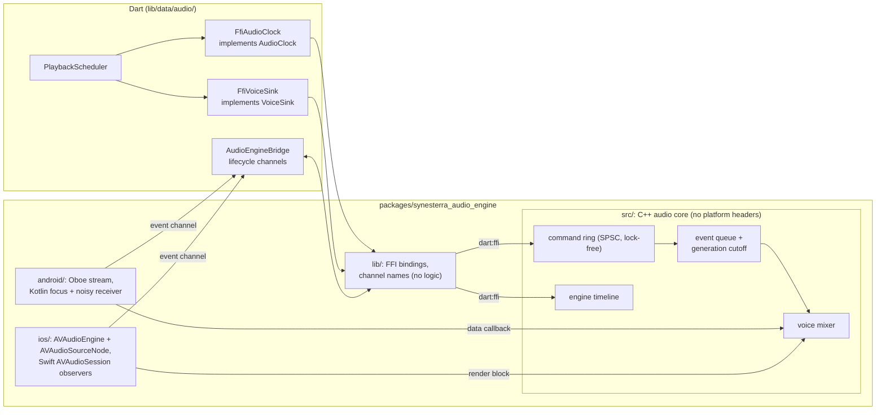
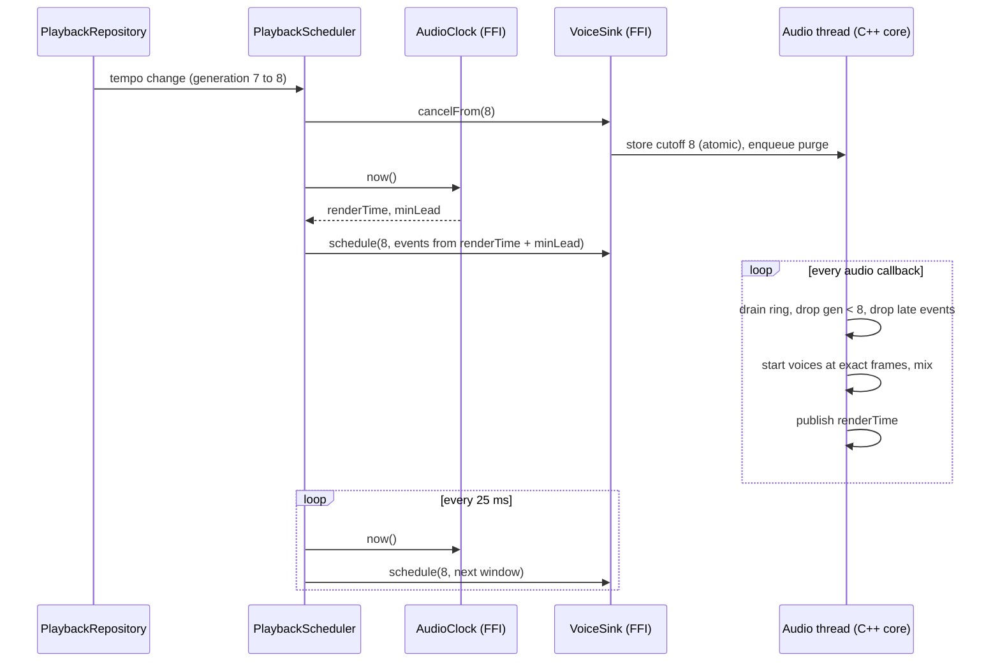
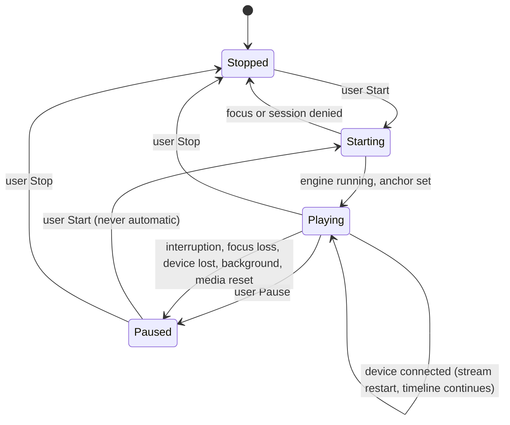

# 0002 — Native audio backend and scheduling hand-off

- **Status:** proposed (`architecture` gate, issue #16). Waits for the Founder.
- **Date:** 2026-10-02
- **Builds on:** [0001](0001-architecture-style.md) (real-time hand-off, ports `AudioClock` and `VoiceSink`, generation rule).
- **Evidence level:** `static`. Nothing in this record was measured on a device. Every platform behaviour comes from the official documentation listed under [Sources](#sources). Every number marked *hypothesis* waits for the spike.

## Context

Decision 0001 fixed who owns what on the audio path: the native engine is the time source, `TempoMap` is the only beat ↔ audio-time conversion, `PlaybackScheduler` in `lib/data/audio/` wakes up and hands events over, and `VoiceSink` plays events at audio timestamps and drops stale generations. It deliberately left open the engine, the thread model, the lookahead, the `cancelFrom` semantics and how latency is measured. This record closes those questions before any audio code is written.

Inputs:

- Web PLR-004 §4–5 (behaviour reference): a platform adapter owns the monotonic audio time source, lookahead and scheduler wake-up, a `VoiceSink` that executes `RhythmTrigger`s, audio focus and interruptions, background policy, route changes and Bluetooth, and the measurement of real latency. The web lab wakes every 25 ms and plans 100 ms ahead.
- Web PLR-005: Android lists synthesizers, drum machines and music-learning apps as high-performance audio and recommends Oboe/AAudio with low-latency mode and a callback. It recommends a conditional decision, because no physical device was measured. It also proposes a jitter gate (a hypothesis).
- Web PLR-012 and its deliverable `docs/quality/MOBILE_AUDIO_QA.md` in `synesterra-web`: a physical-device QA protocol with a device matrix, scenarios A–E, metrics, threshold hypotheses and a `pass` / `conditional pass` / `fail` form. The spike below reuses it.
- This repository: Flutter 3.35.7 (Dart 3.9), Android `minSdk` 24 (the Flutter default, `flutter.minSdkVersion`), iOS deployment target 13.0. The host is Windows, so iOS builds only in the on-demand macOS CI job ([docs/testing.md](../testing.md)).

### Requirements for the backend

Options below are scored against these.

| ID | Requirement | Source |
|---|---|---|
| B1 | Events start at an exact audio-clock position (sample-accurate), not "as soon as possible" | 0001 hand-off; `change-safety` invariant "the time source is the platform audio clock" |
| B2 | The engine exposes a readable, monotonic audio clock | 0001 `AudioClock` |
| B3 | Pending events can be discarded by generation; an older generation never starts after cancel | 0001 generation rule |
| B4 | Late events are skipped, never replayed as a burst | `change-safety` invariant |
| B5 | Polyphony: several layers plus a drone, overlapping one-shots | PLR-004 §4.2, Resonara |
| B6 | Low, stable output latency; separate reporting of route latency (Bluetooth) | PLR-012 §5 |
| B7 | We control the audio session, focus, interruptions and route changes, and nothing resumes without an explicit Start | PLR-005 invariants; PLR-012 safety rule |
| B8 | Real-time code can be tested without a device | 0001 forces ("deterministic and testable without a device") |
| B9 | No new dependency without a concrete need; any native library is justified in the PR | `change-safety` |

## Decision (summary)

| Question | Decision |
|---|---|
| Android engine | **Oboe** (C++), output stream with `PerformanceMode::LowLatency`, a data callback, `Usage::Game`, the device's native sample rate, exclusive sharing requested (shared accepted) |
| iOS engine | **AVAudioEngine with one `AVAudioSourceNode`** whose render block calls the shared C++ core. `AVAudioSession` category `.playback` |
| Shared code | One **C++ audio core** used by both platforms: command ring, event queue, generation filter, voice mixer, engine timeline. No platform headers. |
| Packaging | A local Flutter FFI plugin package `packages/synesterra_audio_engine/` (legacy `plugin_ffi` template, which works on Flutter 3.35 and gives access to the Flutter plugin API) |
| Hot path (clock, schedule, cancel) | **`dart:ffi`**, synchronous calls into the C++ core |
| Lifecycle (session, focus, interruptions, routes, engine start/stop) | **Platform channels** (a method channel and an event channel), handled in Kotlin and Swift |
| `AudioClock` time | `AudioTime` in microseconds on an **engine timeline** that is monotonic for the life of the process |
| Scheduler wake-up | `Timer.periodic` every **25 ms** plus an immediate replan on every state change; horizon **200 ms** ahead of the render position (both tunable, *hypothesis*) |
| Scheduler thread | The root isolate first. A dedicated background isolate is the planned fallback if the spike's wake-up gate fails. |
| Interruptions | The native side silences first and reports afterwards. The transport pauses with `generation++`. **No automatic resume, ever.** |
| Background | **Foreground-only for 1.0** (recommendation, Founder decision). The screen stays awake while the transport plays. |
| Measurement | Engine-internal logs (frame-exact) plus physical onset measurement with the PLR-012 protocol |

The rest of this record explains each row.

## Options

### Android

| Option | B1 | B2 | B3/B4 | B6 | Notes | Verdict |
|---|---|---|---|---|---|---|
| **Oboe** (C++ wrapper over AAudio/OpenSL ES) | own mixer: yes | `getTimestamp` (AAudio only) | own queue: yes | low-latency mode, MMAP exclusive when granted | Android's recommended native audio library [A1]. It calls AAudio on API 27+ and OpenSL ES below [A4] [A5], which covers our `minSdk` 24. It is added as a prefab Maven dependency [A7]. | **chosen** |
| AAudio directly | own mixer: yes | `AAudioStream_getTimestamp`, API 26+ [A3] | yes | same as Oboe on 27+ | No fallback below API 26, so `minSdk` 24–25 would need our own OpenSL ES path. Same API shape as Oboe [A1]. | rejected: Oboe adds the fallback and disconnect handling for little cost |
| OpenSL ES directly | yes | weaker | yes | higher | "Not recommended for new designs" [A1] | rejected |
| Java `AudioTrack`/`SoundPool` | no sample-accurate start | no | no | higher | — | rejected |

Facts that shape the Android design:

- The lowest latency needs `PerformanceMode::LowLatency` with a high-priority data callback [A2] [A4]. The native sample rate avoids a higher-latency resampling path [A4]. Exclusive streams may get MMAP access for the lowest latency but are "more likely to get disconnected" [A2] [A4]. `Usage::Game` helps latency, "especially when connected to Bluetooth headsets" [A4].
- The callback must not allocate, take locks, do file or network I/O, sleep, or stop or close the stream [A6]. The core is designed for this (see [Threads](#threads)).
- A stream is disconnected when headphones are unplugged, when a device stops being the primary device, or on an internal error. A disconnected stream must be stopped and closed, and that must not happen on the error-callback thread [A2]. Oboe's `onErrorAfterClose` is the place to open a new stream [A6].
- `getTimestamp` returns the presentation time of a frame on `CLOCK_MONOTONIC` [A3]. On OpenSL ES streams it returns `ErrorUnimplemented` [A6]. On API 24–26 the clock's output-latency estimate is therefore degraded (see [Risks](#risks)).
- Underruns are counted by `getXRunCount` [A2]. Buffer size is tuned in multiples of the burst size; double buffering is the documented starting point [A2] [A4].

### iOS

| Option | B1 | B3 | B5 | Notes | Verdict |
|---|---|---|---|---|---|
| **AVAudioEngine + `AVAudioSourceNode`** with the shared C++ core in its render block | own mixer: yes | own queue: yes | own mixer | iOS 13+ [I2], which matches our deployment target. The render block receives the HAL timestamp and the frame count [I3]. | **chosen** |
| AVAudioEngine + `AVAudioPlayerNode.scheduleBuffer(at:)` per hit | sample time: yes [I4] | **no per-event cancel**: `stop()` clears *all* scheduled events, including ones playing, and resets the player timeline to sample time 0 [I4] [I5] | needs a pool of player nodes | Cancelling one generation means stopping and rescheduling every pending buffer and re-anchoring the player timeline. Each platform would also need different real-time logic. | rejected |
| Core Audio RemoteIO audio unit directly | yes | yes | yes | Lowest level, more glue code. The same C++ render function plugs in. | fallback if AVAudioEngine misses the latency gate |

Facts that shape the iOS design:

- `.playback` keeps audio playing with the Silent switch on and when the screen locks. Playing in the background additionally needs `audio` in `UIBackgroundModes`. By default the category is non-mixable and interrupts other non-mixable sessions [I8] [I16]. `.ambient` is silenced by the Silent switch and by screen lock [I9], which a metronome cannot accept.
- The I/O buffer duration is requested with `setPreferredIOBufferDuration`. The documented minimum is at least 5 ms (256 frames), and lower on some hardware [I10]. `outputLatency` reports output latency, and AirPlay can add about 2 s [I11].
- When the hardware's channel count or sample rate changes, the engine stops, uninitializes and posts `AVAudioEngineConfigurationChange`. The engine must not be torn down inside that handler [I6].
- Interruptions: on iOS 27 and later the session posts life-cycle notifications (`didBecomeInactive`, `resumptionRecommendation`), and new code should adopt them. On iOS 26 and earlier, observe `interruptionNotification` [I13] [I12]. Since iOS 10 the system deactivates the session of a suspended app and reports it only when the app runs again [I12].
- Route changes: when headphones are disconnected, apps "should … automatically pause playback". When headphones are connected, playback continues [I14].
- After a media-services reset, rebuild the audio objects and the session configuration, and do not restart playback until the user initiates it [I15].

### Existing Flutter audio plugins

| Plugin | What it offers | Against the requirements | Verdict |
|---|---|---|---|
| `just_audio` | Gapless file/stream playlists; background through `just_audio_background` [P1] | No documented API for starting at an audio-clock time (B1) or reading the clock (B2) | rejected |
| `audioplayers` | Several simultaneous players; a low-latency mode [P2] | No documented scheduled start or clock (B1, B2) | rejected |
| `flutter_soloud` (SoLoud + miniaudio over FFI) | `playScheduled` at an absolute engine time "with sample accuracy", `getEngineTime`, `getPlayheadTime` [P3] [P4] | Meets B1/B2. The documentation we reviewed does not describe the audio session, focus, interruption, route or low-latency stream configuration (B6, B7), and a second owner of `AVAudioSession` would conflict with our lifecycle code. Generation cancel would mean tracking voice handles in Dart (B3). The whole engine is a large third-party C++ codebase on the riskiest path (B8, B9). | **rejected as primary; first fallback** if our own engine cannot pass the spike for engine reasons |
| `audio_session` | Configures `AVAudioSession` and Android audio attributes and focus; streams for interruption and becoming-noisy events; no playback [P5] | Reactions would go through Dart, but B7 needs native-first silencing. Kotlin/Swift code to own this is small. | rejected (may be reconsidered if the lifecycle code grows) |

### Dart ↔ native transport

| Option | Hot-path cost | Jank exposure | Threading | Verdict |
|---|---|---|---|---|
| **`dart:ffi` synchronous calls** | No serialization; "considerably faster than platform channels" [F2] | A call costs microseconds and is bounded by batch size | Runs on the calling isolate's thread; FFI works in any isolate | **chosen for clock, schedule, cancel** |
| Method channel for `schedule`, event channel for the clock | Async messages with `StandardMessageCodec` serialization [F1] | Clock readings arrive through the event loop and are stale by the time they are used | Platform handlers run on the platform main thread unless the Task Queue API is used [F1] | rejected for the hot path |
| **Platform channels for lifecycle** | Low-rate messages | Acceptable | Kotlin/Swift code receives focus, session and route callbacks natively | **chosen for lifecycle** |
| `NativeCallable.listener` (native → Dart) | Async, callable from any thread, `void` only [F6] | — | Messages land in the isolate's event loop | kept for later (for example, an engine-fault signal from a C++ control thread). Never called on the audio thread. |

Two Flutter facts set the threading model:

- Since Flutter 3.29, on Android and iOS, "the UI and platform threads are merged … the Dart code runs on the native platform thread" [F2]. The root isolate, its timers and the platform-channel handlers therefore share the main thread with UI work, so a long frame delays the scheduler's wake-up. The horizon absorbs this (see [PlaybackScheduler](#playbackscheduler-wake-up-and-lookahead)), and the background-isolate fallback exists for when it does not.
- Background isolates can call FFI and, through `BackgroundIsolateBinaryMessenger`, send platform-channel messages. They cannot receive unsolicited messages from the platform [F5] [F1]. A background scheduler isolate would therefore get lifecycle events relayed from the root isolate.

Packaging: on Android, FFI binds only to dynamic `.so` libraries. On iOS, static linking is loaded with `DynamicLibrary.process()` [F3] [F4]. Since Flutter 3.38 the docs recommend `package_ffi` with build hooks. The legacy `plugin_ffi` template remains the option that gives access to the Flutter plugin API and static linking on iOS [F3] [F4]. We need both, for the Kotlin/Swift lifecycle code, and we are on 3.35. A local plugin package also avoids hand-editing `Runner.xcodeproj` on a host without Xcode: a podspec with source globs is plain text.

## Engine design



- The C++ core owns everything that runs on the audio thread. It has no Android or Apple headers, so CI can build and test it on Linux against a fake device that renders N frames (B8).
- The Android and iOS hosts own only the device stream and the platform lifecycle. Each calls the same `render(frames, deviceTimestamp)` entry point.
- The package does not depend on `synesterra_core`. The Dart adapters in `lib/data/audio/` map core types to the engine's C structs, so the engine stays generic and the core stays pure (R1).
- The sound bank (preloaded PCM or simple synthesis for clicks and drone) is loaded at engine start, never on the audio thread. The implementation task chooses the sounds.

### Engine timeline

`AudioTime` is an integer number of microseconds on one engine timeline.

- While a device stream runs, the timeline advances by **rendered frames** ÷ sample rate. It is the audio clock, so it has no drift against the output.
- While no stream runs (stopped, or during a stream restart after a route change), it advances by the host monotonic clock (`CLOCK_MONOTONIC` on Android, host time on iOS).
- It never goes backwards and never restarts for the life of the process. A stream restart or a sample-rate change does not invalidate already-computed `AudioTime`s. The native side converts `AudioTime` → frame with the current stream's anchor and rate. Rounding stays below one frame (about 21 µs at 48 kHz).

This is simpler than exposing raw frame counters, which restart with every stream (Oboe reopen, AVAudioEngine restart after a configuration change [I6]).

### Threads

| Thread | Work | Rules |
|---|---|---|
| Audio callback (Oboe high-priority data callback / AVAudioEngine render block) | Drain the command ring; drop events older than the generation cutoff or already late; start voices at their exact frame offset; mix; publish `(renderFrame, timelineTime)` through a seqlock | No allocation, locks, I/O, sleep or stream control [A6]. Fixed-capacity pools allocated at engine start. |
| Dart scheduler isolate (the root isolate first, which is the platform main thread since Flutter 3.29 [F2]) | `AudioClock.now()`, planning, `VoiceSink.schedule` / `cancelFrom` over FFI | Single producer: every FFI write comes from one isolate. A call never blocks and is O(batch size). |
| Platform main thread | Method/event channel handlers, focus listener, `AVAudioSession` notifications (posted on the main thread [I12] [I15]) | Low rate. Silences the core directly (native-first), then reports to Dart. |
| Native control thread | Reopening a disconnected Oboe stream (not on the error-callback thread [A2]); periodic `getTimestamp` for the latency estimate | Never touches the mixer except through the core's control API |

## Ports

These are the signatures the core's `ports/` will declare. Under R2, `ports` may use `playback` types. `AudioTime` and `Generation` live in `playback/`, because `TempoMap` produces `AudioTime`.

```dart
// packages/synesterra_core/lib/src/playback/audio_time.dart
/// A point on the engine timeline, in microseconds. Monotonic for the life of
/// the process. Validated non-negative on construction.
final class AudioTime implements Comparable<AudioTime> {
  AudioTime(this.microseconds);
  final int microseconds;
  AudioTime operator +(Duration offset);
  Duration operator -(AudioTime other);
}

// packages/synesterra_core/lib/src/ports/audio_clock.dart
enum EngineState { stopped, starting, running, interrupted }

final class AudioClockReading {
  /// Timeline time of the first frame the engine has not rendered yet.
  final AudioTime renderTime;

  /// Estimated timeline time of the frame leaving the output now
  /// (renderTime minus output latency). For position display and visuals only.
  final AudioTime outputTime;

  /// Smallest safe distance between renderTime and an event handed to
  /// VoiceSink (about one callback period plus margin, reported by the engine).
  final Duration minLead;

  final EngineState state;
}

abstract interface class AudioClock {
  /// Synchronous and cheap: an atomic read of state the audio thread
  /// published. Never waits for the audio thread.
  AudioClockReading now();
}

// packages/synesterra_core/lib/src/ports/voice_sink.dart
sealed class VoiceEvent {
  /// When the event starts, on the engine timeline. Never a beat.
  AudioTime get at;

  /// Correlates the planned event with the engine's execution log (QA).
  int get eventId;
}

/// A one-shot voice (a rhythm hit). Gain and pan already include the mix.
final class Trigger implements VoiceEvent { /* at, eventId, sound, gain, pan */ }

/// Starts, or retunes, a sustained voice identified by key (the drone).
final class SustainOn implements VoiceEvent { /* at, eventId, key, sound, gain, pan */ }

/// Releases a sustained voice with a short ramp.
final class SustainOff implements VoiceEvent { /* at, eventId, key */ }

abstract interface class VoiceSink {
  /// Queues events planned under [generation]. Never blocks. Returns
  /// normally even when it drops events; drops are counted in diagnostics.
  void schedule(Generation generation, List<VoiceEvent> events);

  /// From now on, only events of [generation] or newer may start.
  void cancelFrom(Generation generation);
}
```

The parameters of a drone voice (pitch set, timbre) are fixed by the first harmony audio task. This record fixes only timing and generation semantics.

### `schedule` semantics

1. Events are copied into a staging buffer that the engine allocates once, then committed into the command ring. There is no per-call allocation on either side, and `package:ffi` is not needed.
2. A batch whose generation is older than the current cutoff is dropped as a whole and counted as `stale`.
3. When the audio thread dequeues an event whose frame has already been rendered, it **drops** the event and counts it as `late`. It never plays an event late, so a stall produces a gap, never a burst (B4).
4. If the ring or the event pool is full, the overflowing events are dropped, counted as `overflow` and reported as an engine fault. Capacities come from the session validation limits (maximum density × horizon), with a 2× margin.

### `cancelFrom(generation)` semantics

1. `cancelFrom` stores the cutoff in an atomic that the audio thread reads **before starting each voice**, and enqueues a purge command into the ring. Ordering is preserved: a `cancelFrom` followed by `schedule` of the new generation is applied in that order.
2. After the cutoff is stored, no pending event of an older generation starts. The only older audio that can still sound is what is already in the device buffer (at most the output buffer, about `minLead`). Software cannot recall it.
3. One-shot voices already sounding finish their natural envelope. Clicks are short, and cutting them on every tempo-drag step would itself be audible.
4. Sustained voices of an older generation are **orphaned**, not cut. A `SustainOn` of a newer generation with the same key whose `at` falls within the adoption window (default 2 × `minLead`, *hypothesis*) **adopts** the voice: no retrigger, parameters ramp to the new values. An orphan that nobody adopts is released with a short ramp when the window ends. This keeps the drone continuous across a tempo or scene change and still silences it on pause and stop, where nothing new is scheduled.
5. Cutoffs are monotonic. A `cancelFrom` with a generation that is not newer than the current cutoff does nothing.

## PlaybackScheduler: wake-up and lookahead

```text
plannedToBeat: Beat?   // end of the last planned window (exclusive)

replan(reason):        // on every tick and immediately on every state change
  r = clock.now()
  if runtime.transport != playing or r.state != running: return
  if runtime.generation != lastGeneration:
    sink.cancelFrom(runtime.generation)
    lastGeneration = runtime.generation
    plannedToBeat = null                        // plan again from the current time
  earliest = r.renderTime + r.minLead
  fromBeat = max(plannedToBeat ?? anchorBeat, TempoMap.beatAt(earliest))   // skip-late, never plan the past
  toBeat   = TempoMap.beatAt(r.renderTime + horizon)
  if toBeat <= fromBeat: return
  events = EventPlanner(project, runtime, [fromBeat, toBeat))              // half-open window
  sink.schedule(runtime.generation, events.map(TempoMap.audioTimeOf))
  plannedToBeat = toBeat
```

- **Wake-up:** `Timer.periodic(25 ms)`. Timers only wake the scheduler; they never measure time (`change-safety`). A state change from `PlaybackRepository` calls `replan` synchronously, so pause, tempo and scene changes take effect after `minLead`, not after a tick.
- **Horizon:** 200 ms ahead of `renderTime` (*hypothesis*, tuned in the spike). A larger horizon does not delay user changes, because a generation change re-plans from `renderTime + minLead` at once. It costs only discarded planning work and queue capacity. In exchange it hides a Dart stall of up to about `horizon − minLead` without any audible effect.
- **Window continuity:** the next window starts exactly at the previous `toBeat`, kept in beats rather than recomputed from time, so rounding can never double or drop a hit at a boundary. The only forward jump is the skip-late `max(...)`. After a stall, the beats between `plannedToBeat` and `beatAt(earliest)` are skipped on purpose.
- **Start:** `PlaybackRepository` asks `AudioEngineBridge` to start (focus or session activation, then stream start). When the engine reports `running`, the transport anchors its start beat at `renderTime + minLead + startPad` (default 30 ms, *hypothesis*) and calls `replan`.
- **Position for the UI:** `TempoMap.beatAt(outputTime)`, read-only. It is what the listener hears, apart from the display's own latency, which is measured separately.
- **Fallback:** if the spike's wake-up gate fails on the root isolate, `PlaybackScheduler` moves into a long-lived background isolate [F5]. That isolate receives immutable `SessionProject`/`RuntimePerformanceState` snapshots over a `SendPort` and calls FFI itself. The ports and the single-producer rule do not change. The extra state copy is the cost, which is why this is not the first choice.



## Interruptions, audio focus, routes, Bluetooth and background

Policy: **the native side silences first, then reports.** Kotlin and Swift react inside the platform callback: a short gain ramp to silence in the core, then the stream stops if the event requires it. They then send an event over the event channel. `PlaybackRepository` moves the transport to `paused` and increments `generation` (an interruption is one of the generation triggers in 0001). The engine never resumes by itself. Playback continues only after the user presses Start. This deliberately ignores the platform hints that would allow automatic resume (`AUDIOFOCUS_GAIN` after a transient loss [A8], `shouldResume` on iOS [I13]), following the PLR-005 and PLR-012 rule.

| Event | Android signal | iOS signal | Native reaction | Transport |
|---|---|---|---|---|
| Phone call, assistant, alarm, another app takes audio | `AUDIOFOCUS_LOSS` or `AUDIOFOCUS_LOSS_TRANSIENT` [A8] | `didBecomeInactive` (iOS 27+) or `interruptionNotification` `.began` [I13] [I12] | Ramp to silence, stop the stream | `paused`, `generation++`; Start required |
| Another app ducks us (navigation prompt) | `AUDIOFOCUS_LOSS_TRANSIENT_CAN_DUCK`; Android 8+ ducks automatically [A8] | (session-dependent) | Keep playing, ducked by the system | unchanged |
| Headphones or Bluetooth disconnected | `ACTION_AUDIO_BECOMING_NOISY` [A9]; the stream is disconnected [A2] | `routeChangeNotification`, reason `oldDeviceUnavailable` [I14] | Ramp to silence; reopen the stream on the new default device but stay silent | `paused`, `generation++` (Apple: "automatically pause" [I14]; Android: users expect apps with playback controls to pause [A9]) |
| Headphones or Bluetooth connected | The stream is disconnected because the device is no longer primary [A2] | `newDeviceAvailable` [I14]; `AVAudioEngineConfigurationChange` if the rate or channels change [I6] | Reopen or restart on the new route; the timeline continues; events that fell into the gap are dropped as late | keeps playing (Apple: connecting headphones continues playback [I14]); a route event goes to the UI and diagnostics |
| Media services reset (iOS) | — | `mediaServicesWereResetNotification` [I15] | Rebuild the engine and session configuration | `paused`, `generation++`; Start required [I15] |
| App leaves the foreground | `AppLifecycleState.hidden`/`paused` [F7] | same [F7] | Ramp to silence, stop the stream, abandon focus or deactivate the session [I12] | `paused`, `generation++` (foreground-only) |
| App `inactive` (control centre, app switcher, call banner) | [F7] | [F7] | none | unchanged; a real interruption arrives through the rows above |

Notes:

- **Focus and session:** Android requests `AUDIOFOCUS_GAIN` with an `AudioFocusRequest`, usage game and content type music, and delayed gain accepted [A8]. From Android 12 the system enforces focus, fades out the losing app and mutes it [A8]. iOS uses `.playback`, non-mixable for 1.0 [I8].
- **Background (proposal: foreground-only for 1.0).** Playing in the background would need, on Android, a foreground service of type `mediaPlayback` with `FOREGROUND_SERVICE_MEDIA_PLAYBACK` (types required since Android 14) [A10]; apps targeting Android 15 cannot request focus unless they are the top app or run a foreground service [A8]. On iOS it would need `audio` in `UIBackgroundModes` [I8] [I16]. Without these, iOS deactivates the session of a suspended app [I12], so locking the screen stops sound. Instead, 1.0 keeps the screen awake while the transport plays (`FLAG_KEEP_SCREEN_ON` / `isIdleTimerDisabled`, native one-liners, no plugin). Background or locked-screen playback is a Founder decision (see [Founder decisions](#founder-decisions)). If it is accepted, PLR-012 scenario B becomes a pass criterion instead of a documented limitation.
- **Bluetooth:** Bluetooth adds a large, stable output latency, which is reported separately and never counted as scheduler jitter (PLR-012 §4D). `outputTime` uses the platform latency estimate (`getTimestamp` [A3], `outputLatency` [I11]) so that visuals follow what is heard. The estimate is checked physically in the spike.
- **Stream lifetime:** the stream opens on Start. While the app is in the foreground and paused, it stays open rendering silence for an idle timeout (default 10 s, *hypothesis*), so Start stays fast. It closes on Stop, on background or when the timeout expires. Exclusive streams should be closed when not needed [A2], and a stopped engine saves power [I5].



## Latency and jitter measurement

Two independent sources, never mixed:

| Layer | What | How | Proves |
|---|---|---|---|
| Engine-internal (diagnostic builds) | For each `eventId`: planned frame, rendered frame, or `late`/`stale`/`overflow`; xruns (`getXRunCount` [A2]; on iOS, discontinuities in the render timestamp's sample time); callback duration against the buffer period | A ring buffer of fixed records in the core, exported to a file after the run | That the software is exact: rendered frame = planned frame, no losses, real-time headroom |
| Scheduler | Wake-up lateness (actual minus intended), planning time, **lead margin** = event time − `renderTime` at enqueue (its minimum is how close we came to a `late` drop) | Counters in `PlaybackScheduler`, exported with the engine log | That the Dart side keeps ahead of the audio thread under UI load |
| Physical | Output latency, jitter (after subtracting the stable route offset), drift over 30 min, lost and double onsets, listening | The PLR-012 §5 methods: electrical loopback or measurement microphone, onset detection, two listeners | What a musician hears. Only this is `device` evidence. |
| Platform estimates | `getTimestamp`/`outputLatency` compared with the physical output latency | Both recorded in the same run | Whether `outputTime` can drive visuals |

Context for the hypotheses: Android's `android.hardware.audio.low_latency` feature means continuous output latency of 45 ms or less, and `android.hardware.audio.pro` means round-trip latency of 20 ms or less [A11]. The spike records both flags per device. `docs/QA.md` in this repository does not exist yet. The spike task copies the PLR-012 protocol into it (the `QA` area), so it can be read from any worktree.

## Spike plan

A separate `AUD` task (with the `QA` protocol), after this decision is accepted. It builds a thin vertical slice: the engine package, the two adapters, a `PlaybackScheduler` with a fixed fixture, and diagnostics export. There is no UI beyond Start/Pause/Stop/tempo/scene and a stress toggle that animates a heavy widget. If the `DOM` planner is not ready, the fixture is a precomputed event list in JSON for 3:2 and 5:4. Its order is compared with the planner later (PLR-012 §8).

| Stage | Where | Content | Evidence |
|---|---|---|---|
| S0 | Linux CI | C++ core tests with a fake device: exact onset frames, half-open windows, `cancelFrom` cutoff and purge, sustain adoption and orphan release, late drop with no burst, ring overflow. Dart `PlaybackScheduler` tests with fake `AudioClock`/`VoiceSink` (PLR-004 §9 adapter list: large time jump, generation cancel, start with a future anchor, pause/resume/stop). | `unit` |
| S1 | Android reference device (Pixel or Android One, API 27+) | PLR-012 scenario A (3:2, 5:4; 20/90/300 BPM; 2 and 4 layers; maximum density; drone; Pause → Start, Stop → Start; tempo change while playing), plus E (30 min). Speaker, wired, Bluetooth. With and without the UI stress toggle. | `device` |
| S2 | same | PLR-012 B (background/lock, foreground-only expected), C (interruption ×2), D (route changes and Bluetooth) | `device` |
| S3 | Current iPhone (build and signing through the macOS CI job; see [Risks](#risks)) | S1 + S2 on iOS, plus media-services reset (Developer settings [I15]) | `device` |

The full 4-device matrix (PLR-012 §3) belongs to the release gate, not to the spike.

### Go/no-go thresholds

All values are *hypotheses* for the Founder to accept or change (PLR-012 §5 for the physical ones). Report n, p50, p95 and max, as PLR-012 requires, never only "pass".

| # | Criterion | Go | Source |
|---|---|---|---|
| G1 | Engine exactness | 100 % of non-dropped events start at the planned frame (±1 frame) | engine log |
| G2 | Losses and doubles in stable foreground, 30 min | 0 `late`, 0 `overflow`, 0 lost, 0 double; no growth in active voices | engine log + recording spot check |
| G3 | Scheduler headroom, root isolate, with UI stress | minimum lead margin > 0 throughout; wake-up lateness p99 ≤ 20 ms, max ≤ 100 ms | scheduler log |
| G4 | Jitter, speaker/wired | p50 ≤ 2 ms, p95 ≤ 5 ms, max ≤ 20 ms | physical (PLR-012) |
| G5 | Drift over 30 min | ≤ 5 ms | physical (PLR-012) |
| G6 | Output latency, speaker/wired | p50 ≤ 50 ms, p95 ≤ 80 ms, max ≤ 120 ms; Bluetooth reported, no limit | physical (PLR-012) |
| G7 | Generation | after a tempo or scene change or a pause: no older-generation start after the cutoff (log); no audible retrigger of the drone on a tempo change (listening) | engine log + listening |
| G8 | Lifecycle | every row of the lifecycle table behaves as specified; no crash, no burst, no automatic resume, unambiguous transport state | PLR-012 B–D |
| G9 | Real-time headroom | audio callback duration p99 ≤ 50 % of the buffer period; listening ≥ 4/5 from two listeners | engine log + listening |

What a failure leads to:

| Failed | Meaning | Next step |
|---|---|---|
| G1, G2, G7 | A bug in our engine, not in the architecture | Fix and re-run S0–S1 |
| G3 only | The root isolate is too busy | Move `PlaybackScheduler` to the background isolate (planned fallback), re-run S1 |
| G4–G6 on Android | Device or stream configuration | Check that exclusive/MMAP was granted, the burst multiple, and the low-latency feature flag; if the device class cannot do better, document it as a `conditional pass` |
| G4–G6 on iOS | Buffer or engine overhead | A smaller preferred I/O buffer [I10]; then the RemoteIO fallback |
| G8 | Policy or implementation | Fix; a policy change goes back to the Founder |
| Our engine still fails after these steps, for engine reasons | — | Reopen this ADR and measure `flutter_soloud` with the same harness |

The result uses the PLR-012 classes: `pass`, `conditional pass` (for example foreground-only, or one route with a documented limitation) or `fail`. The worst required combination decides.

## Risks

| Risk | Mitigation |
|---|---|
| Root-isolate wake-ups are delayed by UI work, since Dart shares the platform main thread [F2] | 200 ms horizon, skip-late with no burst, G3 with a stress toggle, the background-isolate fallback |
| Android 24–26 runs on OpenSL ES, where `getTimestamp` is unimplemented [A6] and latency is higher | `outputTime` falls back to frames written minus the reported buffer; the spike runs on API 27+; raising `minSdk` to 27 is a Founder/`MOB` question |
| Exclusive streams disconnect more often [A2] | Reopen on a control thread [A2] [A6]; exclusive is requested, never required |
| AVAudioEngine stops on configuration changes [I6] | Restart on an internal queue outside the notification handler, with a timeline that continues (late events are dropped) |
| iOS cannot be built or signed on the Windows host | iOS builds run in the macOS CI job. Installing on a physical iPhone needs signing (an Apple developer account and provisioning, never committed). S3 is blocked until the Founder provides it. |
| C++ real-time bugs (data races, allocation in the callback) are invisible to `flutter test` | Core tests in S0; a sanitizer job (ASan/TSan) on Linux in the implementation task; review checks the callback rules |
| Interruption APIs are changing on iOS 27 [I13] | Observe the life-cycle notifications on 27+ and `interruptionNotification` below |
| Native dependencies: Oboe (Maven prefab [A7]) and the C++ toolchain (CMake/NDK) | Justified in the implementation PR (`change-safety`); Oboe is the library Android recommends [A1] |
| The emulator says nothing about latency or Bluetooth | Never reported as evidence (`docs/testing.md`) |

## Alternatives rejected

| Alternative | Why not |
|---|---|
| Per-platform engines with no shared core (Kotlin `AudioTrack` + Swift `AVAudioPlayerNode`) | Two implementations of the real-time rules (generation cutoff, skip-late, adoption) to keep identical. `AVAudioPlayerNode` cannot cancel one event [I5]. Not testable off-device. |
| `flutter_soloud` as the engine | Meets B1/B2, but session, focus, route and low-latency configuration are not documented for our needs (B6, B7), and a large third-party engine sits on the riskiest path. It stays the first fallback. |
| Platform channels for the hot path | Asynchronous and serialized [F1]; the clock reading is stale; handlers run on the platform main thread [F1] |
| Native-driven wake-up (the audio thread asks Dart for more events) | A callback from the audio thread into Dart violates the callback rules [A6]. A control-thread relay adds a moving part without beating a 25 ms timer plus a 200 ms horizon. |
| Frame counters as `AudioTime` | They restart with every stream; route changes would invalidate planned events |
| Host clock (`CLOCK_MONOTONIC`) as `AudioTime` during playback | Drifts against the device clock over a 30-minute session; the music should follow the output |
| Background playback in 1.0 | A foreground service with a notification, a background mode and review implications [A10] [I16] for a promise the product has not made. Kept as a Founder decision. |
| `package_ffi` with build hooks | Recommended from Flutter 3.38 [F3], but it has no Flutter plugin API for the Kotlin/Swift lifecycle code, and we are on 3.35. Revisit with a Flutter upgrade. |

## Consequences

- Positive:
  - One C++ core carries every real-time rule, is tested on Linux CI, and is shared by both platforms.
  - The ports stay engine-agnostic. `flutter_soloud` or RemoteIO can replace the engine without touching the core or the scheduler.
  - Lifecycle safety does not depend on Dart being responsive: the native side silences first.
  - Measurement separates software exactness from physical sound.
- Negative:
  - C++, Kotlin and Swift code to maintain. The CI needs a CMake/NDK build and a C++ test job.
  - iOS work is blocked on signing for physical devices.
  - Foreground-only means no playback with a locked screen in 1.0, unless the Founder decides otherwise.
- Changes to decision 0001, for the implementation task, after acceptance:
  - The layout gains `packages/synesterra_audio_engine/` (a local FFI plugin: C++ core, Android and iOS hosts, raw bindings). In 0001, `android/` and `ios/` stay the generated runners plus app-level settings (manifest, `Info.plist`, keep-awake).
  - The architecture tests treat the package like a plugin: only `lib/data/audio/` imports it (R5, R7).
  - `docs/architecture.md` adds the package box in the same PR that creates it. This record does not edit `0001` or `docs/architecture.md`.

## Not now, and when to revisit

| Deferred | Revisit when |
|---|---|
| Background/locked-screen playback | The Founder makes it a 1.0 promise |
| Mixing with other apps (practising along with a music app: `.mixWithOthers`, no exclusive focus) | Product asks for play-along; a settings option |
| Upgrading Flutter to 3.38+ and build hooks | A separate `MOB` task upgrades Flutter |
| `NativeCallable.listener` for engine faults | Polling diagnostics on each tick turns out to be too slow to report faults |
| Raising Android `minSdk` to 27 | The spike shows the OpenSL ES path cannot meet the gates |

## Founder decisions

```markdown
Decision: accept the audio backend and the scheduling hand-off in ADR 0002.
Options:
  A (recommended) own thin engine: shared C++ core + Oboe + AVAudioEngine/AVAudioSourceNode,
    dart:ffi for clock/schedule/cancel, platform channels for lifecycle.
    Cost: C++/Kotlin/Swift code and a C++ CI job. Risk: ours to test. Reversible behind the ports.
  B flutter_soloud as the engine. Cost: lower start-up work. Risk: lifecycle and latency
    configuration outside our control; large third-party engine. Reversible behind the ports.
Recommendation: A, with B as the measured fallback.
Evidence: this record (static; official documentation cited). No device measurement yet.
Also to confirm:
  1. Background policy for 1.0: foreground-only plus screen kept awake (recommended), or background playback.
  2. Spike thresholds G1–G9 (hypotheses; physical ones from PLR-012).
  3. Android minSdk: keep 24 (OpenSL ES on 24–26, best effort) or raise to 27.
  4. Apple signing for the iOS device stage (S3).
If undecided: the spike task and all native audio code wait; DOM/UX work continues.
```

## Sources

Android (Android Developers and the Oboe project):

[A1]: https://developer.android.com/ndk/guides/audio
[A2]: https://developer.android.com/ndk/guides/audio/aaudio/aaudio
[A3]: https://developer.android.com/ndk/reference/group/audio
[A4]: https://developer.android.com/games/sdk/oboe/low-latency-audio
[A5]: https://github.com/google/oboe
[A6]: https://github.com/google/oboe/blob/main/docs/FullGuide.md
[A7]: https://github.com/google/oboe/blob/main/docs/GettingStarted.md
[A8]: https://developer.android.com/media/optimize/audio-focus
[A9]: https://developer.android.com/media/platform/output
[A10]: https://developer.android.com/develop/background-work/services/fgs/service-types
[A11]: https://developer.android.com/ndk/guides/audio/audio-latency

- [A1] [High-performance audio](https://developer.android.com/ndk/guides/audio): Oboe recommended; OpenSL ES not for new designs; music-learning apps and drum machines are high-performance use cases.
- [A2] [AAudio](https://developer.android.com/ndk/guides/audio/aaudio/aaudio): performance and sharing modes, disconnection, error callback threading, burst and buffer size, xrun count.
- [A3] [AAudio reference](https://developer.android.com/ndk/reference/group/audio): `AAudioStream_getTimestamp` (API 26), clock id, frame position.
- [A4] [Low-latency audio with Oboe](https://developer.android.com/games/sdk/oboe/low-latency-audio): low-latency mode, exclusive/MMAP, native sample rate, double buffering, usage game and Bluetooth, AAudio on API 27+.
- [A5] [Oboe README](https://github.com/google/oboe): API 16+, OpenSL ES on 16+ or AAudio on 27+.
- [A6] [Oboe full guide](https://github.com/google/oboe/blob/main/docs/FullGuide.md): what the callback must not do, `getTimestamp` unimplemented on OpenSL ES, disconnect callbacks.
- [A7] [Oboe getting started](https://github.com/google/oboe/blob/main/docs/GettingStarted.md): prefab Maven dependency, CMake, shared STL.
- [A8] [Audio focus](https://developer.android.com/media/optimize/audio-focus): `AudioFocusRequest`, loss types, automatic ducking, enforcement from Android 12, the Android 15 restriction.
- [A9] [Audio output](https://developer.android.com/media/platform/output): `ACTION_AUDIO_BECOMING_NOISY`.
- [A10] [Foreground service types](https://developer.android.com/develop/background-work/services/fgs/service-types): `mediaPlayback`, the permission, types required since Android 14.
- [A11] [Audio latency](https://developer.android.com/ndk/guides/audio/audio-latency): definitions, loopback measurement, `low_latency` and `pro` feature flags.

Apple (Apple Developer Documentation):

[I1]: https://developer.apple.com/documentation/avfaudio/avaudioengine
[I2]: https://developer.apple.com/documentation/avfaudio/avaudiosourcenode
[I3]: https://developer.apple.com/documentation/avfaudio/avaudiosourcenoderenderblock
[I4]: https://developer.apple.com/documentation/avfaudio/avaudioplayernode
[I5]: https://developer.apple.com/documentation/avfaudio/avaudioplayernode/stop()
[I6]: https://developer.apple.com/documentation/foundation/nsnotification/name-swift.struct/avaudioengineconfigurationchange
[I7]: https://developer.apple.com/documentation/avfaudio/avaudiotime
[I8]: https://developer.apple.com/documentation/avfaudio/avaudiosession/category-swift.struct/playback
[I9]: https://developer.apple.com/documentation/avfaudio/avaudiosession/category-swift.struct/ambient
[I10]: https://developer.apple.com/documentation/avfaudio/avaudiosession/setpreferrediobufferduration(_:)
[I11]: https://developer.apple.com/documentation/avfaudio/avaudiosession/outputlatency
[I12]: https://developer.apple.com/documentation/avfaudio/avaudiosession/interruptionnotification
[I13]: https://developer.apple.com/documentation/avfaudio/handling-audio-interruptions
[I14]: https://developer.apple.com/documentation/avfaudio/responding-to-audio-route-changes
[I15]: https://developer.apple.com/documentation/avfaudio/avaudiosession/mediaserviceswereresetnotification
[I16]: https://developer.apple.com/documentation/bundleresources/information-property-list/uibackgroundmodes

- [I1] [AVAudioEngine](https://developer.apple.com/documentation/avfaudio/avaudioengine): the node graph and real-time rendering to the device.
- [I2] [AVAudioSourceNode](https://developer.apple.com/documentation/avfaudio/avaudiosourcenode): supplies audio through a render block; iOS 13.0+.
- [I3] [AVAudioSourceNodeRenderBlock](https://developer.apple.com/documentation/avfaudio/avaudiosourcenoderenderblock): HAL timestamp, frame count.
- [I4] [AVAudioPlayerNode](https://developer.apple.com/documentation/avfaudio/avaudioplayernode): scheduling at sample time or host time; the player timeline.
- [I5] [AVAudioPlayerNode.stop()](https://developer.apple.com/documentation/avfaudio/avaudioplayernode/stop()): clears all scheduled events and resets sample time; stop the engine to save power.
- [I6] [AVAudioEngineConfigurationChange](https://developer.apple.com/documentation/foundation/nsnotification/name-swift.struct/avaudioengineconfigurationchange): the engine stops on a hardware rate or channel change.
- [I7] [AVAudioTime](https://developer.apple.com/documentation/avfaudio/avaudiotime): host time and sample time.
- [I8] [AVAudioSession.Category.playback](https://developer.apple.com/documentation/avfaudio/avaudiosession/category-swift.struct/playback): Silent switch, screen lock, the background mode, non-mixable by default.
- [I9] [AVAudioSession.Category.ambient](https://developer.apple.com/documentation/avfaudio/avaudiosession/category-swift.struct/ambient): silenced by the switch and by lock.
- [I10] [setPreferredIOBufferDuration(_:)](https://developer.apple.com/documentation/avfaudio/avaudiosession/setpreferrediobufferduration(_:)): I/O buffer range.
- [I11] [outputLatency](https://developer.apple.com/documentation/avfaudio/avaudiosession/outputlatency): output latency; AirPlay delay.
- [I12] [interruptionNotification](https://developer.apple.com/documentation/avfaudio/avaudiosession/interruptionnotification): began/ended, main thread, deactivation on suspension since iOS 10.
- [I13] [Handling audio interruptions](https://developer.apple.com/documentation/avfaudio/handling-audio-interruptions): the iOS 27 life-cycle notifications and the legacy notification.
- [I14] [Responding to audio route changes](https://developer.apple.com/documentation/avfaudio/responding-to-audio-route-changes): pause on headphone removal, continue on connection.
- [I15] [mediaServicesWereResetNotification](https://developer.apple.com/documentation/avfaudio/avaudiosession/mediaserviceswereresetnotification): rebuild objects; no restart without user action.
- [I16] [UIBackgroundModes](https://developer.apple.com/documentation/bundleresources/information-property-list/uibackgroundmodes): background execution modes.

Flutter and Dart (official documentation):

[F1]: https://docs.flutter.dev/platform-integration/platform-channels
[F2]: https://docs.flutter.dev/resources/architectural-overview
[F3]: https://docs.flutter.dev/platform-integration/android/c-interop
[F4]: https://docs.flutter.dev/platform-integration/ios/c-interop
[F5]: https://docs.flutter.dev/perf/isolates
[F6]: https://api.dart.dev/dart-ffi/NativeCallable/NativeCallable.listener.html
[F7]: https://api.flutter.dev/flutter/dart-ui/AppLifecycleState.html

- [F1] [Platform channels](https://docs.flutter.dev/platform-integration/platform-channels): asynchronous messages, the main thread, the Task Queue API, background isolates, `StandardMessageCodec`.
- [F2] [Architectural overview](https://docs.flutter.dev/resources/architectural-overview): UI and platform threads merged on Android and iOS since 3.29; FFI faster than channels.
- [F3] [Android C interop](https://docs.flutter.dev/platform-integration/android/c-interop): `plugin_ffi`, dynamic `.so` only, `package_ffi` + build hooks recommended since 3.38.
- [F4] [iOS C interop](https://docs.flutter.dev/platform-integration/ios/c-interop): static linking and `DynamicLibrary.process`, `@_cdecl`, when the legacy template is still useful.
- [F5] [Isolates](https://docs.flutter.dev/perf/isolates): long-lived isolates, message copying, background isolate platform channels.
- [F6] [NativeCallable.listener](https://api.dart.dev/dart-ffi/NativeCallable/NativeCallable.listener.html): callable from any thread, asynchronous, `void` only.
- [F7] [AppLifecycleState](https://api.flutter.dev/flutter/dart-ui/AppLifecycleState.html): `inactive`, `hidden`, `paused` on iOS and Android.

Flutter plugins (pub.dev, read 2026-10-02):

[P1]: https://pub.dev/packages/just_audio
[P2]: https://pub.dev/packages/audioplayers
[P3]: https://pub.dev/packages/flutter_soloud
[P4]: https://pub.dev/documentation/flutter_soloud/latest/flutter_soloud/SoLoud/playScheduled.html
[P5]: https://pub.dev/packages/audio_session

- [P1] [just_audio](https://pub.dev/packages/just_audio) · [P2] [audioplayers](https://pub.dev/packages/audioplayers) · [P3] [flutter_soloud](https://pub.dev/packages/flutter_soloud) · [P4] [SoLoud.playScheduled](https://pub.dev/documentation/flutter_soloud/latest/flutter_soloud/SoLoud/playScheduled.html) · [P5] [audio_session](https://pub.dev/packages/audio_session)

Web laboratory (read-only, `synesterra-web`, not part of this repository): PLR-004 §4–5, PLR-005, PLR-012 and its deliverable `docs/quality/MOBILE_AUDIO_QA.md`.
