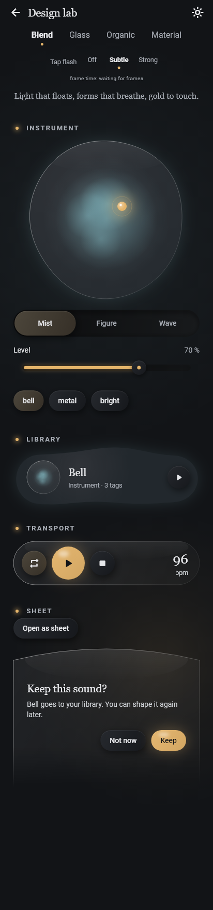
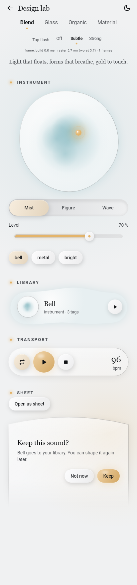
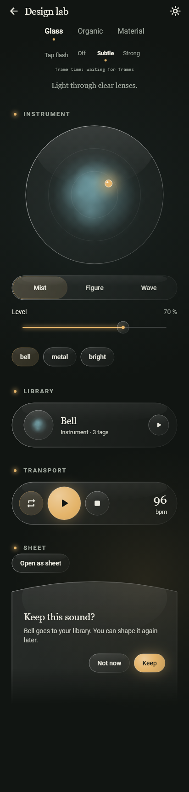
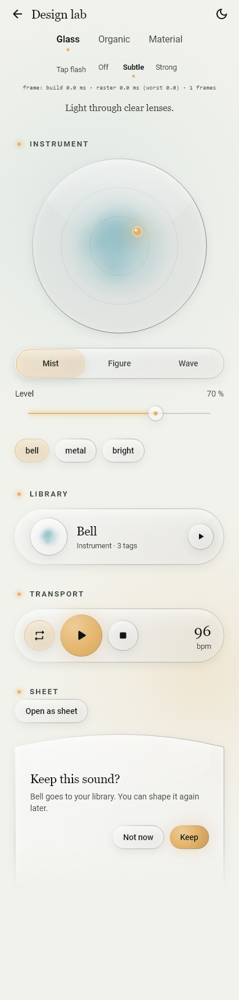
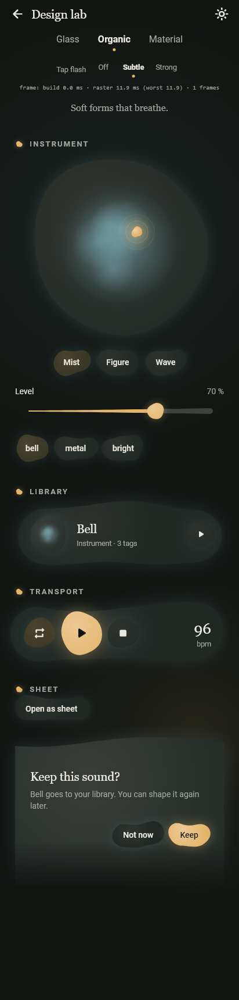
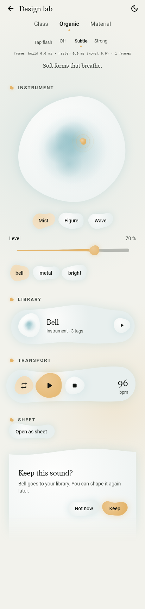
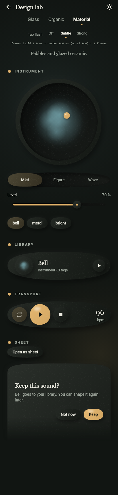
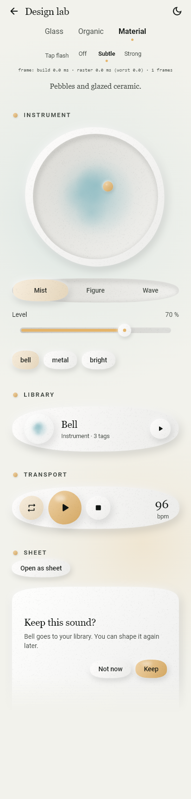

# Design lab (debug only)

A debug-only screen that renders **the same components** in three visual
directions, so the Founder can compare them on a phone and pick one or a blend.
Brief (Founder, 2026-10-13): round shapes (circles and soft organic curves, not
rounded rectangles), minimal (few elements, much space, almost no chrome) and a
touch of magic (soft light, gentle glow, slow drift; never noisy). Addition
(Founder, 2026-10-13): a short glitch / polarization flash as a tap response.

Code: `lib/features/design_lab/`. Nothing here is product UI. Since UX-112 the
lab's proven primitives (round shape paths, the ground palette and contrast
maths, the tap-flash guard) live in `lib/shared/theme/` as visual language v2
(see [design-tokens.md](design-tokens.md)); the lab imports them through
`lab_shapes.dart`, `lab_palette.dart` and `lab_motion.dart` under its old names,
so the three original variants paint exactly as before.

## Decision (Founder, 2026-10-13)

"A mix of the variants would be great; keep all of them." The lab keeps
**Glass, Organic and Material** unchanged as options and adds a fourth tab,
**Blend**, the default style. The blend gives each material one job:

- **Glass** for what floats over the mist: the transport bar, the sheet, the
  vessel of a library card.
- **Organic** for shapes and figures: the pad (a pond that breathes slowly), the
  library card (a soft blob), later the instrument figure and the radar.
- **Tactile** (from Material) for what you press: Play (a glazed gold disc),
  the round Loop and Stop, chips, the segmented control (a tray with the choice
  raised), the slider (a groove filled with gold).
- The tap answers with a short **polarized split** (`TapGlitch`), within the same
  safety limits as the variants' flashes.

The Blend tab is built only from the shared components (`RoundActionButton`,
`RoundIconButton`, `TactileChip`, `RoundSegmented`, `RoundSlider`, `GlassPanel`,
`OrganicCard`, `RoundSurface`, `TapGlitch`) inside an `AmbientScope` that hands
them the lab's palette, drift, tap strength and flash gate. Only its pad, header
mark and sheet preview are lab-local (`blend_canvas.dart`); the real pad is out of
scope. The app's default palette is now **Graphite** (Founder addition, same day);
the lab follows the app palette.

## How to open it

1. `flutter run -d <device>` (a debug build; `flutter build apk --debug` and
   install also works).
2. On the Start screen, **long-press the title "◉ synesterra"**.
3. In release builds the long press does nothing: the entry and the route are
   behind the compile-time constant `kDebugMode` in `lib/app/`, so release
   drops the lab. Tests simulate release with the test-only
   `SynesterraApp(debugHideDesignLab: true)`, which can only hide the lab.

Top of the lab: back, the ground switch (sun / moon icon: dark or light),
the switch **Blend · Glass · Organic · Material** (the lab opens on the Blend), the **Tap flash** strength
(**Off · Subtle · Strong**) and a small frame-time line (average build and
raster time of the last reported frames, and the worst raster time).

## The components

Each variant shows, top to bottom: a section header, the circular instrument
pad (the lab's own painter with the Bell's mist inside; drag the light), a
segmented control (Mist / Figure / Wave), a slider (Level), tags (chips), a
library card (mist in a round vessel, name, kind, small Play), the transport
bar (Loop, Play, Stop, tempo), and a bottom sheet sample (inline preview, and
"Open as sheet" opens it as a real modal sheet). The instrument mist also
drifts very softly behind everything.

## The three variants

| | Glass | Organic | Material |
|---|---|---|---|
| Idea | Light through clear lenses | Soft forms that breathe | Pebbles and glazed ceramic |
| Shapes | Exact circles and capsules | Blobs: capsules and circles pushed in and out by three slow waves, each element with its own asymmetry | Slightly uneven superellipses (pebbles), circles for buttons |
| Surfaces | Translucent gradient fill, soft inner highlight at the top, 1 px light rim; no `BackdropFilter` | Opaque radial light from the top-left, no border, a faint halo in the instrument's colour | Opaque, lit top-left, soft drop shadow, faint fixed grain; concave trays (pad well, segment track, slider groove) |
| Gold | A lit orb with a soft glow | A gold blob with a warm halo | A glazed gold pebble with a glaze highlight |
| Segmented | One glass track, the choice is an inner lens | Three separate blobs | A concave tray, the choice is a raised pebble |
| Slider | Hairline with a glowing gold line, glass bead | A tail that swells from thin to full, gold blob | A groove filled with gold, a pebble thumb |
| Sheet | Lens-shaped top (one shallow arc) | Slow wave along the top | Ceramic slab with a full rounded top |
| Motion | Mist drift; the light on the pad glows slowly | Mist drift; the pad edge and the Play blob breathe | Mist drift; a slow glint on the pad's pebble |
| Tap flash | Polarized sheen: a narrow band of violet, cyan and gold sweeps once across the lens | Chromatic split: a cool and a warm copy of the outline slip apart and snap back | Slice jitter: a few horizontal slices step sideways with a faint gold edge and snap back |

Screenshots (rendered by a widget test with real fonts, Bell instrument; the
drift is frozen at one moment). The Blend is on the Graphite palette; the three
variants were rendered on Forest before Graphite existed:

| | Dark | Light |
|---|---|---|
| Blend |  |  |
| Glass |  |  |
| Organic |  |  |
| Material |  |  |

Tap flash, Strong, about 70 ms into a tap on Play:
`glass-dark-flash.png`, `organic-dark-flash.png`, `material-dark-flash.png`
and the `-light-flash` versions in `docs/assets/design-lab/`; for the Blend,
`blend-dark-flash.png` and `blend-light-flash.png` (the whole screen, about 60 ms
into the flash).

## Rules the lab keeps (tested)

- **Contrast**: every text colour on every surface it is drawn on is at least
  4.5:1, for all four palettes, both grounds, all twelve instrument colours
  and all variants (`test/features/design_lab/lab_contrast_test.dart`; the
  Blend's surfaces in `test/shared/surfaces_test.dart`). The
  test checks the worst case: gradient stops and highlights composited over the
  ground under the brightest point of the mist. One finding: over a lit mist,
  dark glass has no room for a dim second text tier, so its secondary text is
  pulled most of the way toward the main text.
- **Touch targets** at least 48 dp and **labels** for TalkBack on every
  control (`androidTapTargetGuideline`, `labeledTapTargetGuideline`).
- **Reduce motion** (system "remove animations"): the drift and breathing
  stop and the tap flash becomes a plain short fade, no movement.
- **Flash safety**: one flash lasts 220 ms; at most three flashes per second
  across the whole lab (a shared `FlashGate`; a faster retap still works but
  does not flash), small areas only, no full-screen flash (WCAG 2.3.1).
- **Cost**: no `BackdropFilter`, no shaders. Animated layers per variant: the
  mist (all), the pad, and the Play blob (organic only), each behind a
  `RepaintBoundary`. The Blend animates the mist and the pad only. Glows and shadows use `MaskFilter.blur` on small shapes.
  The material grain is computed once per size. The inline sheet preview uses
  one static `saveLayer` for its fade.

No live-blur variant was built (the brief allowed one only as a marked toggle
with measured frame time).

## What to look at on the phone

1. The Blend first, on the dark and the light ground: does it feel like one
   style, minimal with a touch of magic, or like a mix of leftovers? Then each
   variant: is anything from them missing in the Blend?
2. Drag the light on the pad; tap Play, the chips and the segments with Tap
   flash on Subtle and on Strong. Is the flash a touch of magic or noise?
3. Turn on Settings > Accessibility > Remove animations, reopen the lab: still
   pleasant without motion?
4. Watch the frame-time line while the lab idles and while tapping. On a
   Galaxy A33 a frame has 16.7 ms; a debug build is slower than release, so
   treat the numbers as an upper bound.
5. Text readability outdoors / at low brightness, especially secondary text on
   glass.

## Decision record (to fill after the Founder's review)

- Date:
- Chosen direction: a blend of all three, kept as the Blend tab (2026-10-13);
  the three variants stay in the lab. Changes to the Blend after the phone
  review:
- Ground: dark only / dark and light:
- Tap flash: off / subtle / strong, and in which variant's form:
- What to drop or change:
- Follow-up tasks (theme tokens, shared widgets):
