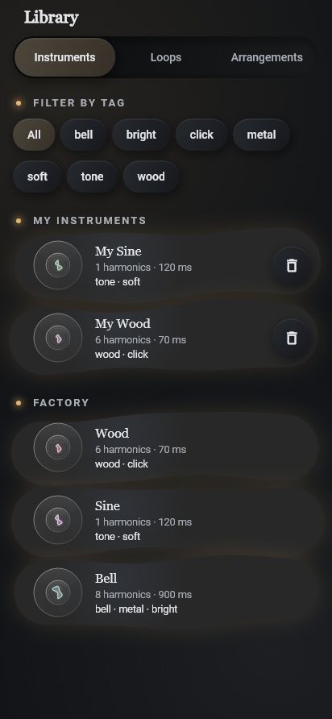
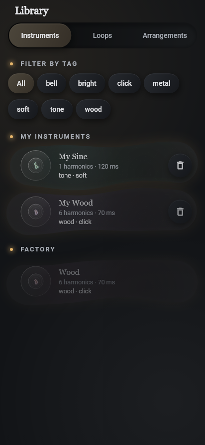
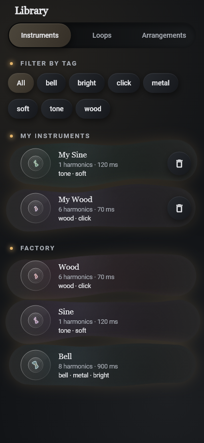
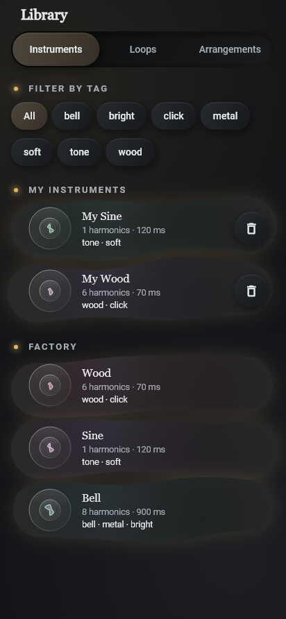
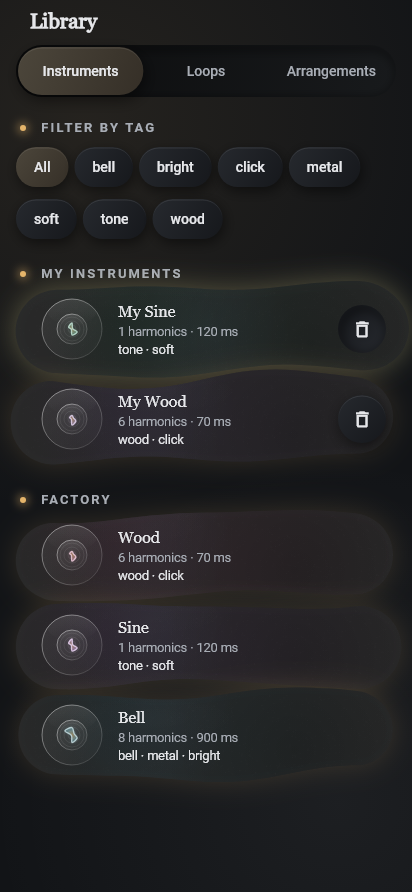
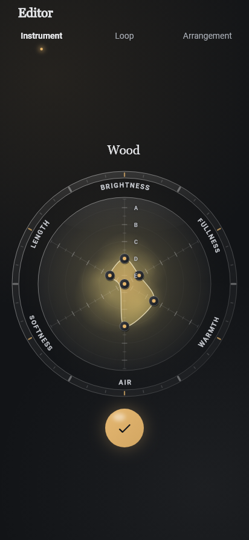
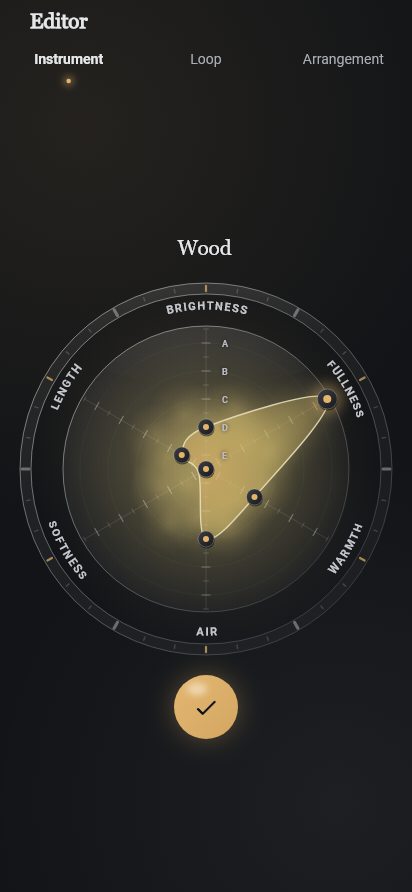
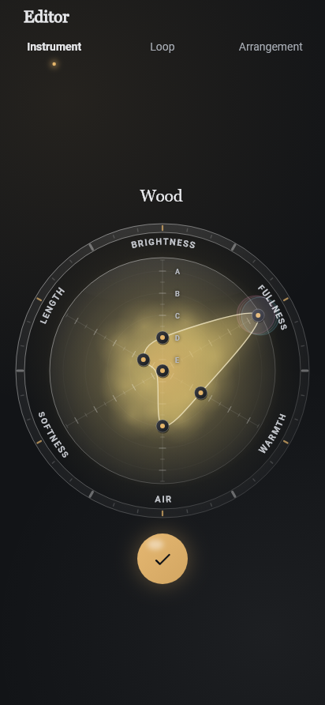

# Living blobs (UX-126)

The Founder's brief (2026-10-14): the blobs in the Editor and the Library (the
instrument mist and the organic library cards) should be more reactive and
animated, less flat. This is the first version; the Founder judges look, feel
and frame rate on the phone.

Code: `lib/shared/living_blobs/`. The shared round components and tokens are
described in [design-tokens.md](design-tokens.md).

## What moves

| Where | Touch | Sound / state | Depth | Organic motion |
|---|---|---|---|---|
| Library cards (instruments, loops, arrangements) | The card leans and bulges toward the finger and swells on a spring (one small wobble, about half a second), then settles back | Pressed, the halo and the inner glow grow brighter | Three translucent gradient layers drifting at different speeds (parallax; the front one also follows the finger most), a wandering soft highlight, an inner glow along the edge, a fixed 1 px grain | The outline morphs slowly on seeded low-frequency noise (seed = the item's id, so each item has its own motion); the cards enter staggered when the library opens |
| The mist behind the stat wheel | Dragging a vertex leans the mist toward the finger and swells it (springs), released it springs back | Each audition (`auditionCount`, passed as `pulseToken`) pulses the mist with the instrument's envelope (attack, then decay) | Halo, lobes and core sit at three depths and drift at their own speeds (parallax) | The lobes breathe in and out on the instrument's own noise |

Instrument cards glow in the instrument's identity colour; loop and
arrangement cards in the ground's aura.

Not done (and why): a loop card breathing with the playback position. The
Library has no playback source today; wiring one in is a data change beyond
"if cheap". There is no persistent selection in the Library, so "the selected
card glows brighter" is the pressed card.

## How it stays cheap (Galaxy A33 first)

- **One clock per gallery.** `LivingField` (around the library's tabs) owns a
  single `Ticker`; every card listens to it only while it animates.
- **Visible cards only, at most six.** After each layout, scroll or size
  change the field picks the cards that overlap its viewport, the most visible
  first (`chooseAnimated`, cap `maxAnimatedBlobs` = 6). The others keep their
  last shape and do not repaint. Cards in the list's cache extent never animate.
  Only slot holders follow the clock at all: a card without a slot shows its full
  card at once (no entrance) and answers a press with the static pressed glow only
  (no spring), so no more than six cards ever repaint per frame.
- **It rests.** Full motion lasts `LivingTiming.awake` (10 s) after the
  library appears, a touch or a scroll, then fades to the still shape over
  1.6 s and the ticker stops: a gallery at rest schedules no frames (the
  existing "the library is still" test holds). The mist behind the wheel does
  the same with its own single ticker.
- **Pauses.** The ticker is muted while the route is covered (`TickerMode`)
  and stopped while the app is not resumed; the first tick after a pause does
  not jump.
- **Layers.** Each card's surface is its own `RepaintBoundary` and its content
  another, so text never repaints with the motion. No `BackdropFilter`, no
  shaders, no `saveLayer` (except the opacity of the short entrance). The
  outline samples (48 points) and the grain are cached per size and seed.
- **Reduce motion** keeps the static depth (layers, highlight, glow, grain at
  rest) and turns off the ticker, the springs, the morph, the pulse and the
  entrance.
- **Flash safety** is unchanged: the tap flash is still the shared
  `TapGlitch` through the `FlashGate`.

## Contrast

On the dark ground there is almost no room to lighten under text (secondary
text on the organic fill is about 5.25:1 at best), so the depth there is
colour without light: the tint is darkened to the fill's own luminance before
it is layered, and a drifting shadow adds depth. On the light ground the layers
are light and tint. `livingFillSamples` stacks every ink at its strongest
(pressed glow included) and a test checks that text and secondary text keep
4.5:1 for every palette, ground, aura and tint.

## Compare it in the design lab (debug only)

The lab's top bar has **Blobs: Flat · Living** (`livingBlobsEnabled`, living
by default in every build; only the lab can switch it). It flips the lab's
**Living gallery** (four factory instruments in a field that never settles, so
the frame-time line under it measures the motion continuously) and the real
Library's cards. The frame-time line shows the average build and raster time
and the worst raster time of the last reported frames.

## Tests

- `test/shared/living_motion_test.dart`: spring step (overshoot, settling,
  stalls), seeded morph noise (stable, bounded, closed, slow), parallax
  (rest, depth order, bounds), the visibility cap, life, entrance, envelope.
- `test/shared/living_mist_test.dart`: the mist's rest, pulse, lean and hold.
- `test/shared/living_field_test.dart`: one ticker, settling, the cap,
  scrolling hands slots over, covered route and backgrounded app pause,
  reduce motion, the spring after a touch, the staggered entrance, the flat
  switch, disposal, semantics and targets, contrast.
- `test/features/editor/radar_living_mist_test.dart`: the mist leans while a
  vertex is dragged, pulses on the audition and comes to rest; still under
  reduce motion.
- `test/features/design_lab/lab_living_test.dart`: the Flat / Living switch
  and the gallery that keeps running.

## Screenshots (Graphite, dark; rendered by a widget test with real fonts)

Motion cannot be shown in a still, so these are moments of it:

| | |
|---|---|
| Flat (before) |  |
| Entrance, 180 ms in |  |
| Living, 2 s |  |
| Living, 7 s |  |
| A finger held at the right of the first card |  |
| Wheel at rest |  |
| Dragging Fullness out (mist leans, swells) |  |
| 40 ms after the release (audition pulse) |  |

## What to look at on the phone

1. Open the Library: do the cards come in one after another, and do they feel
   alive for a while, then rest calmly? Is 10 s of motion the right length?
2. Press and hold a card near one end, then lift: is the lean and wobble
   pleasant, or too much / too little?
3. In the Editor, drag a vertex of the wheel: does the mist follow the finger,
   and does it pulse with the sound when you let go?
4. In the design lab, switch Blobs Flat / Living and read the frame-time line
   while the living gallery moves (16.7 ms per frame; debug builds are slower
   than release). Then compare the Library in both modes.
5. Settings > Accessibility > Remove animations: still pleasant with static
   depth only?
