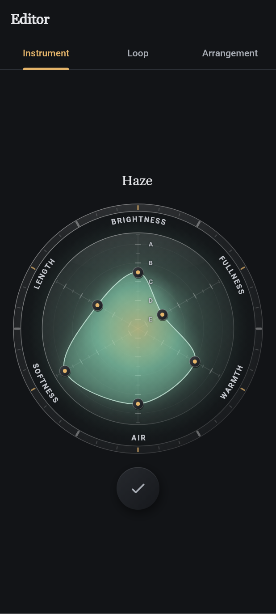
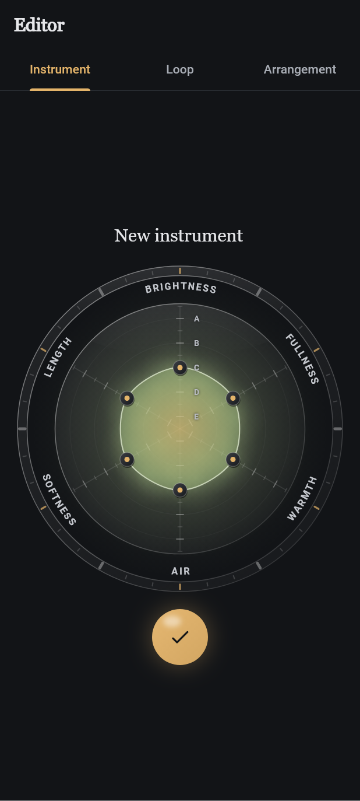
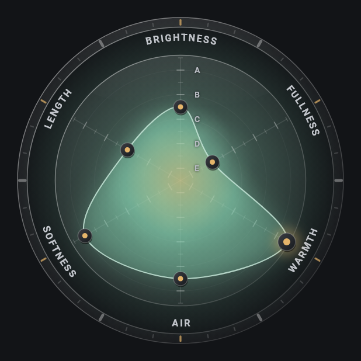
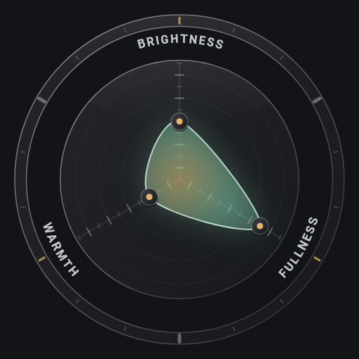
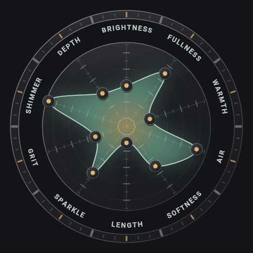

# Instrument radar: the stat wheel

Status: the whole Instrument panel since UX-117 (issue #117, Founder decisions 2026-10-14), after the first radar of UX-115 (issue #115). The panel is **only the stat chart**, in the style of a stats wheel: no sliders, no preset chips, no hint text. The trait mapping and the presets are **untuned**; the Founder judges feel and sound on a phone. Model: [instrument, Traits](../modules/instrument.md#traits).

## Principles (Founder)

- Simple and synaesthetic: the stats of a game character. Each spoke is a plain trait; the centre is low, the edge is high.
- Parameters are set in the chart itself, by dragging a vertex along its spoke. Nothing else beside it except the name and Save.
- Values snap to a **rank scale E, D, C, B, A**: five ranks, each in two half-steps, so ten steps from the centre. The model keeps continuous 0..1 traits; the screen quantizes.
- No technical words on screen. Harmonics, envelope and EQ stay hidden.
- The traits are data (`defaultTraitDefinitions`): the wheel lays out any number of them from three up.
- Visual language v2, Graphite Blend ([design tokens](../modules/design-tokens.md)): glass ring, organic translucent shape, soft glow, the instrument's mist as a glow behind the chart, minimal with a touch of magic.

## On screen

The ring for three and for ten traits (a layout check: the app has six):

Rendered by a scratch widget test with real fonts (Graphite, dark ground, breathing settled); not a phone capture.

From the top:

- **Name**: the instrument's name as a serif title. Tapping it edits it in place (a faint gold underline while editing); an empty name says "Give it a name" and Save waits.
- **Outer ring**: a glass band of tick blocks: a gold block over each trait, a heavier grey divider midway between two traits, quiet blocks between. Just inside it the trait names (`BRIGHTNESS`, `FULLNESS`, `WARMTH`, `AIR`, `SOFTNESS`, `LENGTH`) are **written along the circle**, upper case and tracked out. On the top half they run clockwise, on the bottom half counter-clockwise, so every name reads left to right and upright. All names share one scale, shrunk only when the longest would not fit its sector with a 14 dp gap to its neighbours, so names never overlap for any number of traits.
- **Chart**: a glass disc with one spoke per trait (the first points up, the rest follow clockwise), each graduated in ten steps: a longer mark on the letter steps, a short one on the half-steps, and faint rings through the letter steps. The rank letters **E, D, C, B, A** stand beside the first spoke, E near the centre and A near the edge, drawn over the shape so they stay readable.
- **Shape**: a soft, rounded polygon through the vertices, translucent, filled from a gold core into the instrument's identity colour, with a faint halo and a light rim. It breathes for a few slow breaths (three of 5 s) after it appears and after each change, each vertex with its own phase, then rests. Under reduce motion it never breathes.
- **Glow**: the instrument's mist (`MistSpec`: halo, core and one blob per audible harmonic) as a soft light behind the chart, in the identity colour. It changes with the sound while dragging and swells once (900 ms) after a release. It replaces the separate mist thumbnail.
- **Save**: one round button with a check. Gold while there is something to save, a quiet disc when saved. A short message confirms a save.
- A line of text appears only when something is wrong: no sound, or saving failed.

## The rank scale

| Step | 0 | 1 | 2 | 3 | 4 | 5 | 6 | 7 | 8 | 9 | 10 |
|---|---|---|---|---|---|---|---|---|---|---|---|
| Value | 0 | 0.1 | 0.2 | 0.3 | 0.4 | 0.5 | 0.6 | 0.7 | 0.8 | 0.9 | 1 |
| Rank | none | E | E+ | D | D+ | C | C+ | B | B+ | A | A+ |

The letter sits on its full step (an odd step) and the half-step above it adds `+` (spoken "plus"). The middle of the chart (0.5) is rank C, so the neutral shape is all C.

## Interaction

- A touch on a handle (within 24 dp) grabs that spoke without moving it; a touch along a spoke (within 24 dp of it) grabs that spoke and sets the step there. A touch away from every spoke does nothing and plays nothing.
- While dragging, only the grabbed trait changes: the touch is projected onto the spoke (the part across it is ignored), clamped to 0..1 and **snapped to the nearest step**. The vertex glides to a new step in 90 ms (it jumps under reduce motion). Each new step calls the wheel's `onStep`, the place for a light haptic tick (see *Known limits*).
- Handles on top of each other (several traits at the centre) are told apart by the first move: the touch picks the spoke it moves along.
- The whole wheel takes the gesture at once (`ImmediatePanDetector`), so touching it never scrolls the page.
- On lift the sound plays once through the existing audition path, the released handle answers with the polarized tap accent (`TapGlitchPainter`, 220 ms) through the shared `FlashGate` (at most three flashes per second across the screen, a plain fade under reduce motion, nothing with the effect off) and the glow swells. A drag the system cancels (a call, a system gesture) stops silently: no sound, no accent, the shape keeps its last value.

## Opening and saving

- A new instrument starts from the `neutral` preset (every trait at C), mapped by `instrumentForTraits`.
- An instrument from the library, or a copy of a factory one, is read with `traitsForInstrument`. The model keeps those continuous traits; the wheel shows them **snapped to the steps**. Nothing is rewritten when it opens. If the mapped sound of that shape differs from the stored recipe (harmonics by more than 0.01, attack or decay by more than 1 ms, EQ by more than 0.1 dB), or a trait is off the steps, the shape is an approximation; this is said to screen readers only.
- The first move replaces the whole draft with the mapped recipe (`instrumentForTraits`, keeping id, name and tags). The library changes only on Save.
- The presets (`traitPresets`: `neutral`, `warm drone`, `airy pad`, `bass`, `guitar`, `click`) stay as data in the core. The panel offers none; a shape that matches one is named to screen readers.

## Accessibility

- Every spoke is one adjustable control (TalkBack slider) labelled with its plain trait name, valued by its rank ("C", "C plus", "none"), with increase and decrease to the neighbouring step. Each step plays the sound once and glides the shape there (it jumps under reduce motion). Its target is at least 48 dp, over the name on the ring.
- The whole wheel has a description, for example "Sound shape, neutral: everything in the middle", followed by "The shape is an approximation of this sound." when it is one.
- The name field is labelled "Name"; Save is a button labelled "Save".

## Library cards

Each instrument card in the library shows a small, still chart of the instrument's traits (the same painters, bare: no ring, names, handles or motion) in its identity colour.

## Cost

No `BackdropFilter` and no shaders. Four painters behind their own `RepaintBoundary` layers: the glow, the static field (ring, names, spokes), the moving shape and the static rank letters. The field paints once per palette. Continuous animation: only the breathing bout (about 15 s) after a change; plus the 320 ms glide, the 90 ms snap glide, the 900 ms swell and the 220 ms accent. Blurs use `MaskFilter.blur` on the shape and the active handle only. All controllers are disposed.

## Known limits

- **Haptic tick not wired yet.** Decision 0001 (R5) keeps `package:flutter/services.dart` out of `lib/features/` and `lib/shared/`, so the wheel cannot call `HapticFeedback` itself. It calls `onStep` on every new step, and `InstrumentPanel(stepFeedback:)` passes it on; the app does not give one yet (follow-up: a platform feedback port wired in `lib/app/`).
- Below about four harmonics the core cannot read brightness back (it reads 0.5), so a very thin sound reopens with brightness at C.

## Code and tests

- `lib/shared/instrument_radar/radar_geometry.dart`: pure helpers: spoke angles and directions for any N >= 3, `WheelLayout` (tick ring, name band, chart reach; bare for thumbnails), value to point, projection of a touch onto a spoke, which spoke a touch grabs, stacked handles and the pick by the first move, the rank scale (`rankStep`, `snapToRank`, `rankName`, `rankSpoken`, `rankStepFrom`, `spokeTicks`, `rankLetterPoint`), ring ticks (`ringTicks`) and names along the ring (`ringReadsReversed`, `ringLabelSpan`, `ringLabelScale`, `ringGlyphs`). Tests: `test/shared/radar_geometry_test.dart`.
- `lib/shared/instrument_radar/radar_painter.dart` (`RadarGlowPainter`, `RadarFieldPainter`, `RadarRankPainter`, `RadarShapePainter`) and `instrument_radar_thumbnail.dart`.
- `lib/features/editor/instrument_radar_view.dart` (`InstrumentRadar`, `describeRadar`); the panel body (`_WheelBody`, `_NameTitle`, `wheelSide`) in `instrument_panel.dart`; the view model (`traits`, `approximated`, `activePreset`, `setTrait`, `releaseTraits`) in `instrument_editor_view_model.dart`.
- Tests: `test/features/editor/instrument_radar_screen_test.dart`, `radar_step_test.dart`, `radar_cancel_test.dart`, `instrument_radar_view_model_test.dart`, `pad_removed_test.dart`, `test/features/library/library_view_test.dart`, and the instrument flow in `test/flows/prototype_flows_test.dart`. Widget tests are not evidence of feel, sound or frame rate on a phone.
