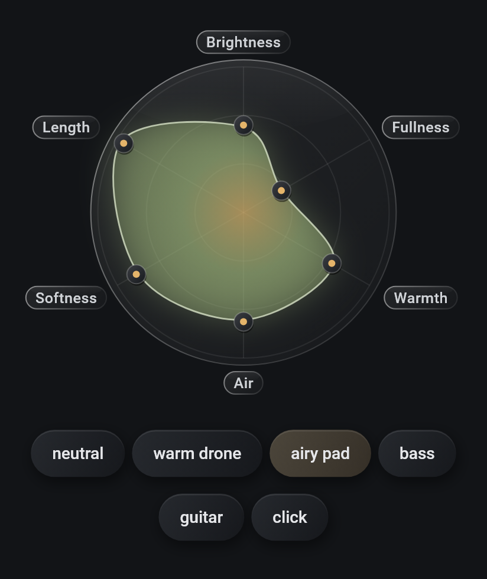
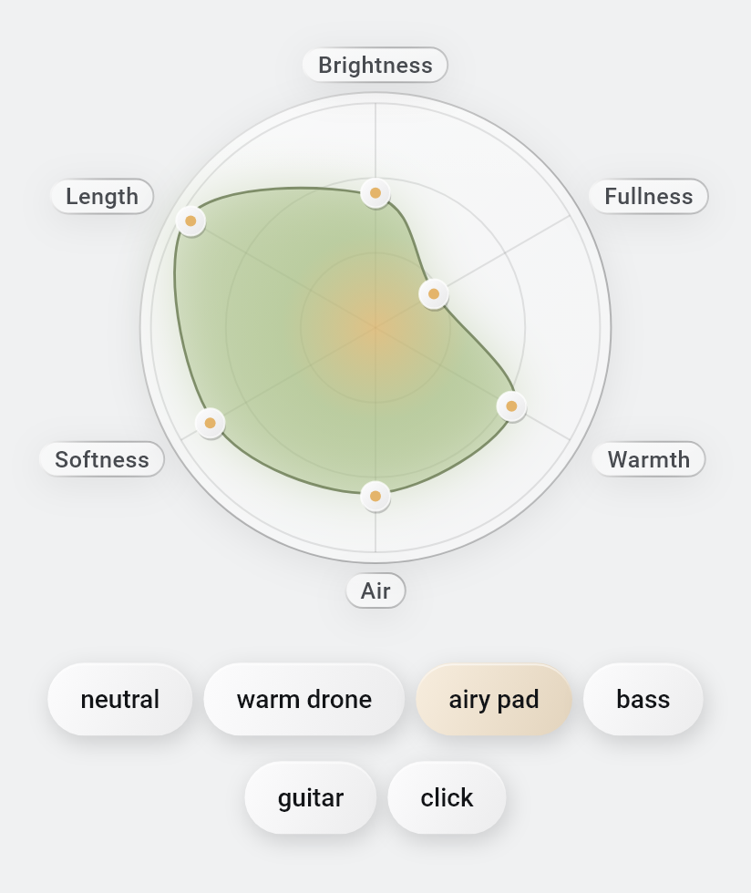

# Instrument radar

Status: the Instrument panel's main control since UX-115 (issue #115, Founder decisions 2026-10-13). It replaces the circular dot pad ([instrument pad](instrument-pad.md), superseded). The trait mapping and the presets are **untuned**; the Founder judges feel and sound on a phone. Model: [instrument, Traits](../modules/instrument.md#traits).

## Principles (Founder)

- Simple and synaesthetic: a radar (stat) chart, like the stats of a game character. Each axis is a plain trait; the centre is low, the edge is high.
- No advanced mode and no technical words on screen. Harmonics, envelope and EQ stay hidden.
- The sound plays once when the finger lifts; the instrument mist reacts live while dragging.
- The traits are data (`defaultTraitDefinitions`): they may be renamed, added or removed later without code changes in the radar.
- Visual language v2 ([design tokens](../modules/design-tokens.md)): an organic shape with a soft gradient and gentle breathing, glass rim and labels, tactile preset chips, minimal with a touch of magic, the default Graphite palette, the polarized tap accent within the safety limits.

## On screen

Full screen, dark: [radar-screen-dark.png](../assets/instrument-radar/radar-screen-dark.png). The light ground exists only as the design lab's proposal; the app itself is dark. Rendered by a widget test with real fonts (breathing frozen); not a phone capture.

- **Field**: a glass disc with three faint rings and one faint line per axis. The axis labels (`Brightness`, `Fullness`, `Warmth`, `Air`, `Softness`, `Length` by default) sit on small glass capsules just outside the edge. The first axis points up; the others follow clockwise at equal angles, for any number of traits from three up.
- **Shape**: a soft, rounded polygon (a smooth closed curve through the vertices) filled with a gradient from a gold core into the instrument's identity colour, with a faint halo and a light rim. It breathes for a few slow breaths (three of 5 s) after it appears and after each change, each vertex with its own phase, then rests. Under reduce motion it never breathes.
- **Handles**: a small tactile disc with a gold dot on every vertex; the one being dragged glows. The touch target is 48 dp.
- **Presets**: tactile chips under the radar: `neutral`, `warm drone`, `airy pad`, `bass`, `guitar`, `click`. The chip whose shape is the current one is selected. Choosing one glides the shape there with a short ease (320 ms, ease-out, no flashing; it jumps under reduce motion) and plays the sound once. The user can adjust the vertices afterwards.
- **Lines**: "Drag a point out for more, in for less. It plays when you let go." When an opened instrument is only approximated by the shape, a second line says "The shape is an approximation of this sound."

## Interaction

- A touch on a handle (within 24 dp) grabs that axis without moving it; a touch along an axis line (within 24 dp of it) grabs that axis and sets the value there. A touch away from every axis does nothing and plays nothing.
- While dragging, only the grabbed trait changes: the touch is projected onto the axis (the part across it is ignored) and clamped to 0..1. The whole radar takes the gesture at once (`ImmediatePanDetector`), so touching it never scrolls the page.
- A drag the system cancels (a call, a system gesture) stops silently: no sound and no accent; the shape keeps its last value.
- On lift the sound plays once through the existing audition path, and the released handle answers with the polarized tap accent (`TapGlitchPainter`, 220 ms) through the shared `FlashGate`: at most three flashes per second across the screen, a plain fade under reduce motion, nothing with the effect off.

## Opening and saving

- A new instrument starts from the plain Sine, which sits exactly on the radar (fullness at the centre).
- An instrument from the library, or a copy of a factory one, shows its traits read by `traitsForInstrument`. Nothing is rewritten when it opens. If the mapped sound of that shape differs from the stored recipe (harmonics by more than 0.01, attack or decay by more than 1 ms, EQ by more than 0.1 dB), the approximation line is shown. A shape that sounds like a preset shows that preset exactly.
- The first move replaces the whole draft with the mapped recipe (`instrumentForTraits`, keeping id, name and tags) and clears the line. The library changes only on Save.
- Known limit: below about four harmonics the core cannot read brightness back (it reads 0.5), so a very thin sound made on the radar with a non-middle brightness reopens with the approximation line. A follow-up in the core could read it from the first two harmonics.

## Accessibility

- Every axis is one adjustable control (TalkBack slider) labelled with its plain trait name, valued in whole percent (`60 percent`), with increase and decrease to the next whole tenth. Each step plays the sound once. Its target is at least 48 dp, over the axis label.
- The whole radar has a description, for example "Sound shape, warm drone: high Softness and Length, low Brightness, Fullness and Air, the rest in the middle".

## Library cards

Each instrument card in the library shows a small, still radar of the instrument's traits (the same painters, without labels, handles or motion) in its identity colour, instead of the mist.

## Cost

No `BackdropFilter` and no shaders. The static field and the moving shape are two painters behind separate `RepaintBoundary` layers; the only continuous animation is the breathing bout (about 15 s), plus the 320 ms glide and the 220 ms accent. Glows use `MaskFilter.blur` on the shape and the active handle only.

## Code and tests

- `lib/shared/instrument_radar/radar_geometry.dart`: pure helpers (axis angle and direction for any N >= 3, reach that leaves room for labels, label boxes, value to point, projection of a touch onto an axis clamped to 0..1, which axis a touch grabs, tenth steps). Tests: `test/shared/radar_geometry_test.dart`.
- `lib/shared/instrument_radar/radar_painter.dart` (`RadarFieldPainter`, `RadarShapePainter`) and `instrument_radar_thumbnail.dart`.
- `lib/features/editor/instrument_radar_view.dart` (`InstrumentRadar`, `describeRadar`); the view model (`traits`, `approximated`, `activePreset`, `setTrait`, `releaseTraits`, `applyPreset`) in `instrument_editor_view_model.dart`.
- Tests: `test/features/editor/instrument_radar_screen_test.dart`, `instrument_radar_view_model_test.dart`, `pad_removed_test.dart`, `radar_cancel_test.dart`, `test/features/library/library_view_test.dart`, and the instrument flow in `test/flows/prototype_flows_test.dart`. Widget tests are not evidence of feel, sound or frame rate on a phone.
