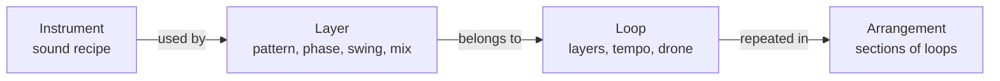
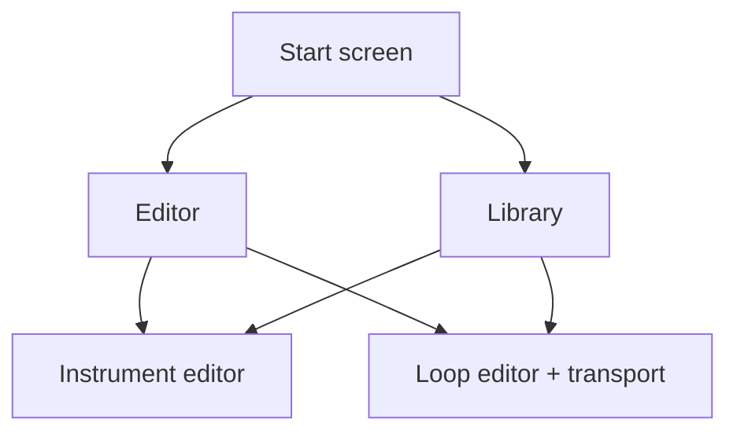

# Product vision (mobile)

Status: draft for Founder review, 2026-10-02. Nothing here is implemented unless stated. It supersedes the navigation model in web PLR-003 (Session with Play/Build/Improvise and a fixed transport dock), which stays a behaviour reference.

Marked **Founder** = stated by the Founder. Marked **Proposal** = recommended by the coordinator, not yet confirmed.

## Product

Synesterra is a mobile instrument for building, practising and developing multi-layer polyrhythms and harmony. The user designs the sound of an instrument, builds loops from layers that each use an instrument, and later chains loops into backing tracks. It sits between a metronome and a drum machine and needs no DAW. Audience, promise and the Build → Challenge → Evolve → Keep → Reuse loop are unchanged from the web vision v0.1.

## Domain model

- **Instrument** (Founder): a sound preset with EQ and the number and strength of harmonics.
- **Loop** (Founder): layers built on the polyrhythmic metronome; every layer has an instrument.
- **Arrangement** (Founder, later): several loops in sequence or a structure built from loops, used as a backing track.
- Library (Founder): instruments, and loops, are stored in a library.
- A Loop embeds the definitions of the instruments it uses, so an exported file is self-contained (Proposal).

## Navigation

### Start screen (Founder)

The start screen offers two entries and nothing else for now:

1. **Editor**: choose what to edit, an Instrument or a Loop.
2. **Library**: instruments and loops.

Later, not part of this scope: shorts and a learning panel.

### Open: returning to the last loop (Proposal, needs a decision)

The web vision required "last session, one deliberate tap on Start". A two-entry start screen has no place for that. Options:

- A: add a single "Continue: <loop name>" card above the two entries. Transport still never starts by itself. Recommended; it is the only addition and keeps the practice use case.
- B: no continue card; the user opens Library, then the loop.
- C: open the last loop directly and skip the start screen on later launches.

## Instrument

- Recipe v1 (Proposal): pitch, N harmonics with an amplitude each, an envelope (attack, decay), 3-band EQ. Noise and a pitch drop (kick, snare) come in v2. Without an envelope every sound is a sustained tone, so one is required for percussion.
- Library of instruments, with factory presets for the three web sounds `wood`, `sine` and `bell`. Web files map onto them.
- Rendered once per edit or load into a PCM buffer; the engine plays buffers. This keeps real-time audio simple and is a requirement to record in ADR 0002 (#16).
- Scope in v1 is rhythm layers only. The drone keeps its current model (Proposal).

## Visualization layer

Two kinds of picture, both driven by state and by the audio clock, never by a UI timer.

| Picture | Where | Driven by | Source |
|---|---|---|---|
| **Instrument mist** | Instrument editor, library cards | the recipe; reacts live to parameter changes | new design |
| **Loop view** (circle, timeline, polygons) | Loop editor | loop state and the audio clock position | as in web `src/visual/views.ts` |

Instrument mist mapping (Proposal, computed deterministically from the recipe, no FFT):

- number of harmonics → number of lobes or rings;
- harmonic strength and EQ → spread and edge sharpness (bright is a wide halo, dark is a dense core);
- decay → how long the pulse fades after a hit.

The web mist today visualizes the harmony of the drone, one blurred radial gradient per chord note. It does not show timbre, so this mapping is new. Layer identity stays number plus colour; the mist never carries state alone (accessibility). On mobile use gradients in a `CustomPainter` and a `RepaintBoundary` instead of a Gaussian blur filter; smoothness is a device-level check.

## Editing layer

- **Loop editor**: layers, one instrument per layer, pattern, accents, phase, swing, mix, tempo and the drone, with the transport dock always visible. Mix changes apply immediately; structural changes wait for the next cycle boundary, or require Stop until the planner can do that safely.
- **Instrument editor**: the recipe above with a live mist preview and an audition control.
- **Arrangement editor** (later): an ordered list of sections, each a loop with a repeat count; changes between sections happen on a cycle boundary. A and B scenes from the web vision are the smallest arrangement.

## Phasing (Proposal)

1. Data model first, while there is no user data: a layer references an `instrumentId` (three factory instruments), a new `SessionDocument` version with a migration. Loop editor, transport and loop view.
2. Instrument editor, instrument library and mist.
3. Arrangements and backing tracks after 1.0, with the section model already fixed in step 1.

## Decisions still open

| # | Decision | Recommendation |
|---|---|---|
| 1 | Does the start screen get a "Continue" card (A, B or C above)? | A |
| 2 | Are instruments also for the drone, or rhythm layers only in v1? | Rhythm only |
| 3 | Do arrangements ship in 1.0 or after? | After, model fixed now |
| 4 | Bump `SessionDocument` to v3 with `instrumentId` now? | Yes |
| 5 | Where do Challenge tools (dropout, tempo ramp, mute) and Improvise live in the new navigation? | A panel in the Loop editor; Improvise stays a mutation controller |
| 6 | Free/Pro boundary for the instrument editor and arrangements | Business gate, later |

This changes the 1.0 scope, so it needs the `product` gate; the start-screen structure also touches the `experience` gate deferred from web PLR-013.
