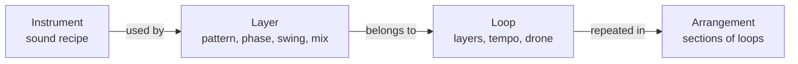
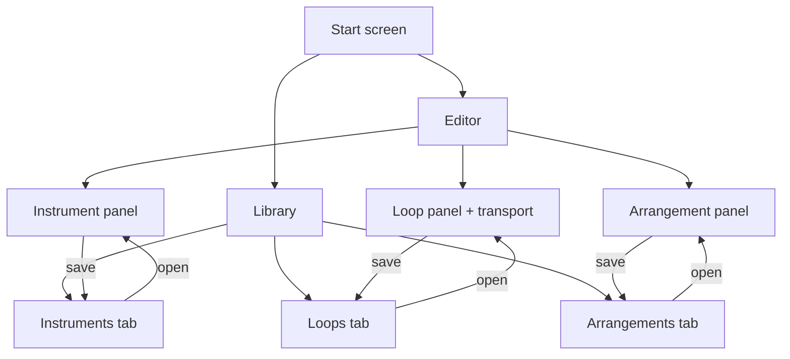

# Product vision (mobile)

Status: draft for Founder review, updated 2026-10-02. Nothing here is implemented unless stated. It supersedes the navigation model in web PLR-003 (Session with Play/Build/Improvise and a fixed transport dock), which stays a behaviour reference.

Marked **Founder** = stated by the Founder. Marked **Proposal** = recommended by the coordinator, not yet confirmed.

## Product

Synesterra is a mobile instrument for building, practising and developing multi-layer polyrhythms and harmony. The user designs the sound of an instrument, builds loops from layers that each use an instrument, and later chains loops into backing tracks. It sits between a metronome and a drum machine and needs no DAW. Audience, promise and the Build → Challenge → Evolve → Keep → Reuse loop are unchanged from the web vision v0.1.

## Domain model

- **Instrument** (Founder): a reusable timbre preset with EQ, the number and strength of harmonics, an envelope and tags. It has **no pitch**: it is the preset for the clicks of a loop layer, and the layer chooses the pitch. In the editor a note, a chord or later a progression is picked only to test how it sounds; that is not stored in the instrument (Founder, 2026-10-02).
- **Loop** (Founder): layers built on the polyrhythmic metronome; every layer has an instrument.
- **Arrangement** (Founder): several loops in sequence or a structure built from loops, used as a backing track.
- Each of the three has its own library (Founder).
- A Loop never embeds instruments: a layer references its instrument by id and the library owns the recipe (Founder, 2026-10-03). Making an exported file self-contained is a separate, later question.

## Navigation

### Start screen (Founder)

The start screen offers two entries and nothing else for now:

1. **Editor**.
2. **Library**.

Not part of this scope: shorts, a learning panel, and a shortcut back to the last loop (the web "one tap Start" rule is dropped for now; Founder, 2026-10-02). A welcome screen appears only on the first launch; its content is not designed yet.

### Editor and Library (Founder)

Inside the Editor there are three panels: **Instrument**, **Loop** and **Arrangement**. The Library has one tab per editor, in the same order. Implementation starts with the Instrument panel and saving to the instrument tab; the Loop and Arrangement panels and tabs are placeholders until their turn.

## Instrument

- Recipe v1 (Proposal): N harmonics with an amplitude each, an envelope (attack, decay), 3-band EQ, tags (no pitch). Noise and a pitch drop (kick, snare) come in v2. Without an envelope every sound is a sustained tone, so one is required for percussion.
- Library of instruments, with factory presets for the three web sounds `wood`, `sine` and `bell`. Web files map onto them.
- Rendered once per edit or load into a PCM buffer; the engine plays buffers. This keeps real-time audio simple and is a requirement to record in ADR 0002 (#16). Until that ADR is decided, the Instrument panel has no audition sound; it edits, previews the mist and saves.
- Experience (Founder, 2026-10-04): simple and synaesthetic. The user shapes a timbre by placing one dot on a 2D pad (dark to bright, soft to hard); harmonics, envelope and EQ are hidden and there is no advanced mode in v1. The pad is a view on the recipe, which does not change. Rules and the first untuned anchors: [instrument pad](instrument-pad.md).
- Scope in v1 is rhythm layers only. The drone keeps its current model (Proposal).

## Visualization layer

Two kinds of picture, both driven by state and by the audio clock, never by a UI timer.

| Picture | Where | Driven by | Source |
|---|---|---|---|
| **Instrument mist** | Instrument panel, library cards | the recipe; reacts live to parameter changes | new design |
| **Loop view** (circle, timeline, polygons) | Loop panel | loop state and the audio clock position | as in web `src/visual/views.ts` |

Instrument mist mapping (Proposal, computed deterministically from the recipe, no FFT):

- number of harmonics → number of lobes or rings;
- harmonic strength and EQ → spread and edge sharpness (bright is a wide halo, dark is a dense core);
- decay → how long the pulse fades after a hit.

The web mist today visualizes the harmony of the drone, one blurred radial gradient per chord note. It does not show timbre, so this mapping is new. Layer identity stays number plus colour; the mist never carries state alone (accessibility). On mobile use gradients in a `CustomPainter` and a `RepaintBoundary` instead of a Gaussian blur filter; smoothness is a device-level check.

### Sound views (instrument panel)

The preview of an instrument has three views of the same recipe: **Mist** (character), **Figure** and **Wave** (the sound itself, after EQ). The figure is the closed curve `z(t) = sum s_n e^(i n t)`: a pure tone is a circle, harmonic n adds n-1 lobes, a bright spectrum is spiky and a dark one smooth. It describes one sound, not a loop (Founder, 2026-10-02). The pulse (the envelope, visually) plays in all three views.

Later, for harmony (the drone and chords, not a single instrument): compose the figures of the chord's notes, or draw a triad as one 3D curve (a major triad 4:5:6 is `x = sin(4t)`, `y = sin(5t)`, `z = sin(6t)`), projected by hand in a `CustomPainter` and rotated by dragging; no new dependency is expected. Idea from the Founder, 2026-10-02; not scheduled.

## Editing layer

- **Loop panel**: layers, one instrument per layer, pattern, accents, phase, swing, mix, tempo and the drone, with the transport dock always visible. Mix changes apply immediately; structural changes wait for the next cycle boundary, or require Stop until the planner can do that safely.
- **Instrument panel**: the recipe above with a live mist preview.
- **Arrangement panel** (later): an ordered list of sections, each a loop with a repeat count; changes between sections happen on a cycle boundary. A and B scenes from the web vision are the smallest arrangement.

## Phasing (Proposal)

1. Instrument panel and instrument library: pure Dart `Instrument` model, local persistence, mist. Start screen, Editor shell with three panels, Library with three tabs (Loop and Arrangement are placeholders).
2. Data model for the Loop: a layer references an `instrumentId` (three factory instruments), a new `SessionDocument` version with a migration; Loop panel, transport and loop view.
3. Arrangements and backing tracks, with the section model already fixed in step 2.

## Decisions still open

| # | Decision | Recommendation |
|---|---|---|
| 1 | Are instruments also for the drone, or rhythm layers only in v1? | Rhythm only |
| 2 | Do arrangements ship in 1.0 or after? | After, model fixed in step 2 |
| 3 | Bump `SessionDocument` to v3 with `instrumentId`? | Yes, in step 2 |
| 4 | Where do Challenge tools (dropout, tempo ramp, mute) and Improvise live? | A panel in the Loop panel; Improvise stays a mutation controller |
| 5 | Free/Pro boundary for the instrument editor and arrangements | Business gate, later |
| 6 | Content of the first-launch welcome screen | Design with the first-launch scenario in #26 |

This changes the 1.0 scope, so it needs the `product` gate; the start-screen structure also touches the `experience` gate deferred from web PLR-013.
